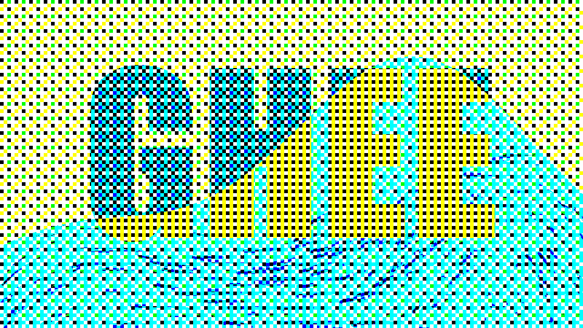
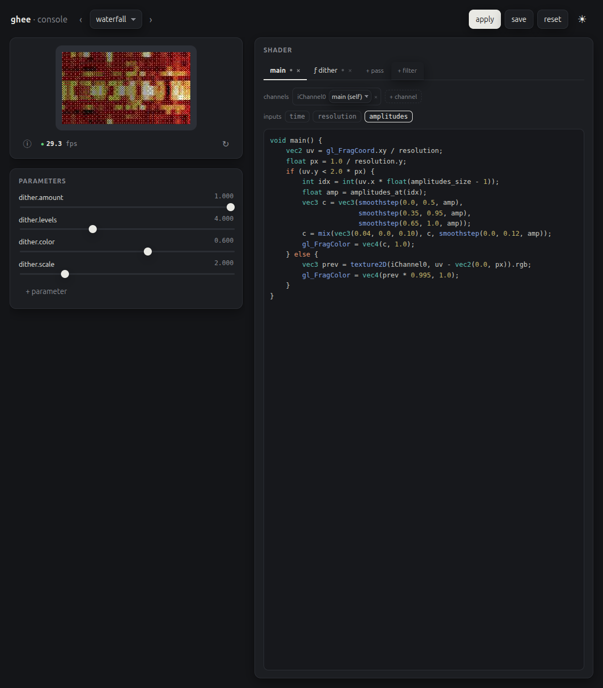

# ghee

ghee runs your GLSL headless on the GPU and puts the frames on an SPI/I2C
panel, HDMI, image files, or an H264 stream. Multi-pass, Shadertoy-style, any
Raspberry Pi.



ghee renders with GLES2 through DRM/GBM on a stock Raspberry Pi OS Lite image,
and it scans its frames straight out to HDMI. ghee teaches no GLSL: [The Book
of Shaders](https://thebookofshaders.com) and
[Shadertoy](https://www.shadertoy.com) have that covered.

## Install

On a Pi, take the deb from the [releases
page](https://github.com/holofermes/ghee/releases). It installs the `ghee`
command, and the Python package for the system Python. The deb is the only
install for the 32-bit Pis:

```
sudo apt install ./ghee_*.deb
```

In a uv project or a venv, on any 64-bit OS, add the Python package:

```
uv add ghee-render                # or, in a venv: pip install ghee-render
```

The Python package holds the library and the shim. `ghee.open` runs the
renderer inside your Python process, with the panel drivers and the console,
and the shim writes [procedural scenes](#procedural-scenes). The package
installs no `ghee` command. That command comes from the deb, or from a [source
build](#build).

## Where does it run?

| Hardware | OS | Driver | Hardware H264 |
| --- | --- | --- | --- |
| Pi 1, Pi Zero, Pi Zero W (armv6) | Raspberry Pi OS bookworm or trixie | vc4 | yes |
| Pi 2, Pi 3, Pi Zero 2 W (arm64) | Raspberry Pi OS bookworm or trixie | vc4 | yes |
| Pi 4, Pi 400 (arm64) | Raspberry Pi OS bookworm or trixie | v3d + vc4 | yes |
| Pi 5 (arm64) | Raspberry Pi OS bookworm or trixie | v3d + vc4 | ffmpeg/libx264 |
| Desktop Linux (x86_64) | any current distro | Mesa | ffmpeg/libx264 |

ghee runs on every Pi back to the Pi 1, and builds ship for all of them. Pi 1
through Pi 4 encode H264 on the Broadcom block. The block needs a frame of
16384 pixels or more, so ghee scales a smaller frame up by the smallest whole
factor that reaches that size, each pixel a square block: a 128x32 panel
streams at 256x64. The Pi 5 has no encoder, so there and on desktop ghee
encodes with ffmpeg/libx264. Install it if needed:

```
sudo apt install ffmpeg
```

## Build

The build needs a Rust toolchain and the GLES/DRM development headers. On
Raspberry Pi OS or Debian:

```
sudo apt install libdrm-dev libgbm-dev libegl1-mesa-dev libgles2-mesa-dev
cargo build --release
```

## Run it

With `--demo`, ghee takes the scene from its bundled [examples](#scenes).

Render one of the JSON scenes to an image sequence of sixty frames:

```
ghee render --demo mix -o frame.####.png --frames 60
```

Render one of the Python [procedural scenes](#procedural-scenes) to the
connected HDMI display, and hand it an argument of its own after `--`:

```
ghee render --demo bluesun --display kms -- --emit 480x300
```

Write raw frames to stdout and pipe them through ffmpeg into an mp4, with
`--timestep` pinning engine time to a fixed 1/60 s step per frame:

```
ghee render --demo bars -o - --frames 300 --timestep 0.0166667 |
  ffmpeg -f rawvideo -pix_fmt rgba -s 320x240 -framerate 60 -i - out.mp4
```

Or stream it as a hardware accelerated H264 Annex-B stream, and pipe it to
mpv:

```
ghee render --demo trail --h264 - --fps 30 | mpv -
```

Or scan it straight out to the HDMI display, as [Hardware
displays](#hardware-displays) describes:

```
ghee render --demo trail --display kms
```

Or drive an SPI or I2C panel:

```
ghee render --demo trail --display st7789
```

Or serve the web [console](#the-console), to preview and author every demo
scene:

```
ghee serve --demo
```

You can combine outputs: one render can write PNGs, drive a panel and stream
H264 at the same time, and `--serve` attaches the console to preview and
author the scene:

```
ghee render --demo bars --display st7789 -o frame.####.png      # panel and a contact sheet
ghee render --demo bars --display st7789 --serve                 # panel, and edit it live
ghee render --demo bars --display kms --serve --host 0.0.0.0     # HDMI, edit from a laptop
```

## Scenes

A scene is a JSON file that holds an ordered list of passes, each with its own
GLSL fragment shader. This is `bars.scene.json`, one of the bundled examples:

```json
{
  "version": 1,
  "passes": [
    {
      "name": "main",
      "fragment": { "file": "bars.glsl" },
      "arrays": [{ "name": "amplitudes", "size": 16 }],
      "params": {
        "base": { "type": "color", "value": [0.04, 0.04, 0.04] },
        "bar": { "type": "color", "value": [0.1, 0.9, 0.4] }
      }
    }
  ]
}
```

and `bars.glsl` beside it:

```glsl
void main() {
  int last = amplitudes_count - 1;
  float fi = uv.x * float(last);
  int i0 = int(floor(fi));
  float h = mix(amplitudes_at(i0), amplitudes_at(min(i0 + 1, last)), fract(fi));
  float m = step(uv.y, h);
  gl_FragColor = vec4(mix(base, bar, m), 1.0);
}
```

A pass's `fragment` holds its GLSL as text, or names a file beside the scene
as `{ "file": "bars.glsl" }`. A scene can also be a program that writes its
own JSON and feeds it data: see [Procedural scenes](#procedural-scenes).

ghee refuses a scene with an unknown key. The error names the key and where it
sits, and it suggests the closest known key, or the object that takes the key:
`"font"` on a layer points to `font_family`, and `"fragment"` on a layer
points to its pass. A key one edit from a key of its own object points there
first, so a scene's `"filter"` points to `filters`.

When GLSL fails to compile, `ghee render` stops with an error. The error opens
with the pass and the line of its code that holds the mistake, as in
`pass 'main', line 2 of its code:`, and the GL's own message follows. A
mistake in the common block reads `line 2 of the common block`.

ghee also looks a scene name up in the directories on `$GHEE_SCENES`, a
colon-separated list. Careful: procedural scenes are executables, and ghee
runs them. Only put directories you trust on `$GHEE_SCENES`.

## How does it work

The pass model follows Shadertoy. The passes render in order, and each pass is
a fragment shader that draws into its own buffer. A pass reads another pass
through a numbered channel sampler. A channel that reads an earlier pass sees
that pass's buffer from this frame. A channel that reads the pass itself, or a
later pass, sees the buffer from the previous frame. ghee sends the last pass
to the output, at the output's size.

A pass renders at the frame's size, at its own `"size": [w, h]` in pixels,
or at `"scale"`, a share of the frame, one number for both sides or `[x, y]`.
A pass takes one of the two. The frame is the render size turned by
`--rotate`, and a scaled side rounds to the nearest pixel, 1 at least, so
this pass blurs at half the frame's size on every screen:

```json
{ "name": "blur", "scale": 0.5, "fragment": { "file": "blur.glsl" } }
```

The last pass ignores a size or a scale, with a warning. A pass samples other
passes in normalized coordinates. A pass with `"mipmaps": true` builds the mip
chain of its buffer after each frame, and every channel that reads the buffer
samples it trilinearly. A buffer drawn small and far away, such as words in
perspective, then stays calm.

A pass with `"visible": false` is hidden. It draws a copy of the pass before
it, or black as the first pass, its layers draw nothing, and the frame is the
last visible pass. A hidden pass keeps its params, arrays and layers, so a set
and a feed still land, and a scene that hides every pass fails to load.

A pass buffer holds 8-bit RGBA, and a channel reads the alpha that its pass
wrote. Every output frame is opaque, with alpha 255, unless
`ghee render --alpha` keeps the output pass's alpha in RGBA frames. ghee then
treats the colour as premultiplied by that alpha, as layers blend it. A raw
frame on `-o -` keeps the colour premultiplied, and a PNG file stores it
straight.

ghee puts a preamble like this one in front of the GLSL of every pass:

```glsl
uniform float iTime;                // seconds since start
uniform float iTimeDelta;           // seconds the last frame took
uniform int   iFrame;               // frame number, 0 first, wraps at 2^20
uniform vec3  iResolution;          // buffer size in pixels, z = 1.0
varying vec2  uv;                   // 0..1 across the buffer, y = 0 at the top
// gl_FragCoord maps to the varying, so its y = 0 is at the
// top too, where Shadertoy has y = 0 at the bottom

// declared array, e.g. {"name": "amplitudes", "size": 16}:
const int amplitudes_count;         // = 16
float amplitudes_at(int i);         // one element
float amplitudes_sample(float t);   // interpolated, t in 0..1, clamped edges
// arrays are bound as 1xN textures

// a 2D input, e.g. {"name": "mask", "size": [96, 16]}:
float mask_sample2(vec2 uv);        // bilinear, normalized uv
// the host feeds w*h floats: a mask, host-rasterized text, an image

// per channel: uniform sampler2D iChannel0..N
// per param:   uniform <type> <name>
// then the scene's common block, if it has one
```

The scene's `common` block holds GLSL that ghee puts after the preamble of
every pass except a filter pass. It takes the two forms of a `fragment`:
`"common": "..."`, or `"common": { "file": "common.glsl" }`.

A pass declares each channel by the name of the buffer that it reads:

```json
{ "name": "compose", "fragment": { "file": "compose.glsl" }, "channels": [{ "buffer": "compose" }] }
```

That pass samples its own previous frame through `iChannel0`:

```glsl
// compose.glsl: everything drawn so far, fading a little each frame
void main() {
  vec3 prev = texture2D(iChannel0, uv).rgb;
  gl_FragColor = vec4(prev * 0.95, 1.0);
}
```

A param is a typed uniform declared on the pass, with optional range metadata:

```json
{ "params": { "gain": { "type": "float", "value": 0.45, "min": 0, "max": 1, "step": 0.01 } } }
```

The preamble turns that into `uniform float gain;`, and the console shows
every param as a live control. The types are `float`, `int`, `bool`, `color`
(a `vec3` in the shader, which takes a [colour](#colours)), `vec2`, `vec3`,
`vec4` and `string`. A string param never reaches the shader: a procedural
scene reads it on its ticks, and `options` turns its text box in the console
into a dropdown. A param declared on the scene, in place of a pass, holds one
value that every pass reads.

A scene declares an asset by its file. ghee decodes the file at setup and
binds it in every pass:

```json
{ "assets": { "noise": { "file": "noise.raw", "width": 32, "height": 32, "format": "u8" } } }
```

ghee looks a relative `file` up in the directory of the scene file, or of a
procedural scene's executable, then in each directory on `$GHEE_ASSETS`, a
colon-separated list. A path may be absolute or climb out with `..`, except
in a scene that [the console](#the-console) serves.

A pass samples the asset as `uniform sampler2D noise_tex`, and reads its size
in pixels in `uniform vec2 noise_size`. Sampling is `nearest` unless the
asset sets `"sampling": "linear"`.

An asset file is a `.png`, a `.jpg`, or a `.raw` file of bare pixels. A `.raw`
file declares `width`, `height` and `format`, `u8` or little-endian `f32`, and
`components` sets 1, 3 or 4 values per pixel, 1 by default. A `.ttf` or `.otf`
file is a font for a [text layer](#text-layers)'s `font_family`, and only the
layer reads it.

### Names

Every pass, layer, asset and scene param of a scene takes a name of its own.
A pass's params and arrays take names unique within the pass that no pass,
layer, asset or scene param holds, so two passes may each declare a param
`gain`. A name holds ASCII letters, digits and `_`, starts with a letter, ends
with a letter or a digit, holds no `__`, and does not start with `gl_` or
`ghee`.

ghee writes these names into every shader: `iTime`, `iTimeDelta`, `iFrame`,
`iResolution`, `uv`, and `iChannel0` and up. A param, an array or an
asset that takes one of them fails to load. A layer may take any name that
the rule allows.

Each declaration adds names to the GLSL of the passes that it reaches:

| Declared | GLSL names | Reaches |
| --- | --- | --- |
| a param `gain` | `gain` | its pass, or every pass for a scene param |
| an array `amplitudes` | `amplitudes_tex`, `amplitudes_count` and the readers in the preamble | its pass |
| an image asset `noise` | `noise_tex`, `noise_size` | every pass except a filter pass |
| a text layer `title` | `title_cover`, `title_size` | every pass except a filter pass |

A font asset and an image layer add no name. A scene fails to load when two
declarations add the same name to one pass, such as a param `title_size`
beside a text layer `title`, and the error names both.

## Layers

A pass's shader fills its buffer, then the pass's `layers` paint over it, in
list order. A text layer draws words from a font, an image layer draws a
picture, and a shape layer draws a rect or a line. Each takes its settings as
keys, and ghee draws them. A pass's shader can also read the words of any text
layer and any image asset, for the per-pixel work that settings do not cover,
as [Coverage in a shader](#coverage-in-a-shader) shows. From Python, the
`draw()` of a `ghee.open` handle writes the same layers from a loop, with no
scene to write first, as [python/README.md](python/README.md#drawing) shows.

This scene draws `hello` in a red to yellow gradient with a soft shadow,
fitted to the frame and centred, and puts the image `stamp.png` 16 pixels wide
in the top left corner:

```json
{
  "version": 1,
  "assets": { "stamp": { "file": "stamp.png" } },
  "passes": [{
    "name": "main",
    "fragment": "void main() { gl_FragColor = vec4(0.1, 0.12, 0.2, 1.0); }",
    "layers": [
      { "name": "title", "text": "hello",
        "color": { "from": "#ff0000", "to": "#ffff00", "angle": 90 },
        "text_shadow": {} },
      { "name": "icon", "image": "stamp", "x": 4, "y": 4, "width": 16 }
    ]
  }]
}
```

Every layer takes these keys:

| Key | Value | Default |
| --- | --- | --- |
| `name` | the layer's name, per [Names](#names) | required |
| `visible` | `false` hides the layer | `true` |
| `x`, `y` | the pass pixel of the block's top left, y down | centred on a missing axis |
| `color` | a [colour](#colours) | white for text and a shape, no tint for an image |
| `opacity` | 0 to 1 | 1 |
| `blend` | `normal`, `add`, `multiply` or `screen` | `normal` |

A layer's colour, premultiplied by alpha, lands on the pass's buffer by its
`blend`, and alpha blends the same way: `normal` gives src + dst × (1 −
src.a), `add` gives src + dst, `multiply` gives src × dst + dst × (1 −
src.a), and `screen` gives src + dst × (1 − src). The formulas of `multiply`
and `screen` hold over an opaque buffer, such as the output of the pass's own
shader. A pass with `layers` and no GLSL of its own starts each frame
transparent and holds its layers alone, for a later pass to read through a
channel. A later pass reads the whole buffer, layers included.

### Colours

A colour is `"#rrggbb"`, `[r, g, b]` with each 0 to 1, or one of the 148
[named colors of CSS Color 4](https://www.w3.org/TR/css-color-4/#named-colors),
such as `"navy"`, in any case. A scene keeps a name as it was written.
`"transparent"` paints nothing: letters in it still draw their effects, and a
gradient to it fades out. A color param reaches its shader as three numbers,
so `transparent` reads there as black.

### Text layers

A text layer takes these keys on top of every layer's:

| Key | Value | Default |
| --- | --- | --- |
| `text` | the words | required |
| `font_size` | pixels per em | the largest size that fits |
| `font_family` | a font asset's name, a `.ttf` or `.otf` file, or `pixel` | DejaVu Sans, built in |
| `text_align` | `left`, `center` or `right` | `left` |
| `render` | `mtsdf` or `slug`, as [Render](#render) describes | `mtsdf`, `slug` in `pixel` |

The words lay out into a block, as wide as the longest line, with one line
height for each line, and `text_align` puts each line within the block. A
layer with no `font_size` takes the largest size at which the block fits
inside the pass, with a margin of 5% of the pass's shorter side on every
edge. On an axis with `x` or `y` given, the room runs from that pixel to the
margin at the far edge. The size follows the words, so new words fit again.

`font_size` sets the size in pixels per em, as a font size does in CSS. One
line of DejaVu Sans is 1.164 em tall, so at 48 pixels per em a line is 56
pixels tall. This status screen puts two lines in the top left corner of a
128x32 panel:

```json
"layers": [
  { "name": "cpu", "text": "cpu 12%", "font_size": 12, "x": 0, "y": 0 },
  { "name": "temp", "text": "temp 41°C", "font_size": 12, "x": 0, "y": 16 }
]
```

A text layer's `color` also takes a gradient, `{"from", "to", "angle"}`, with
CSS's angle in degrees: 0 runs up, 90 right, and 180, the default, down. The
gradient spans the block and moves with it.

ghee declares a scene string param under each text layer's name, which holds
the words. `set_param`, `/set`, the console and a procedural scene set new
words through it, and ghee lays them out again with no rebuild.

### Effects

An effect is a key of a text layer that holds an object of its fields. A field
left out takes its default, so `"glow": {}` draws the default glow. Sizes are
in em, and so scale with the words.

| Effect | Fields and defaults |
| --- | --- |
| `text_shadow` | `x` 0.06, `y` 0.08, `blur` 0.15, `color` `#000000`, `strength` 0.7 |
| `glow` | `blur` 0.3, `color` `#ffa500`, `strength` 0.8 |
| `text_stroke` | `width` 0.06, `color` `#000000` |
| `karaoke` | `sung` 0, `color` `#ffad2e` |
| `wave` | `height` 0.1, `speed` 0.6 |
| `scroll` | `speed` 2 |
| `blink` | `rate` 1 |

- `text_shadow` draws a copy of the letters moved by `x` and `y`, softened
  over `blur`, at `strength` alpha.
- `glow` lights the room around the letters, from `strength` alpha at their
  outline to nothing at `blur`.
- `text_stroke` grows the letters by `width` in its colour.
- `karaoke` fills the letters in its colour up to the `sung` point, which
  counts characters and takes fractions, and lifts the letter being sung by
  up to 0.15 em as the point passes its middle.
- `wave` bobs each letter up and down by `height`, `speed` waves a second,
  each letter a tenth of a wave behind the one before it.
- `scroll` moves the block from right to left, `speed` em a second, by whole
  pixels, so on a 1-bit panel each letter keeps its pixels. The block enters
  at the pass's right edge, and starts there again once it has left at the
  left. The layer's `x` takes no part while it scrolls.
- `blink` shows the layer for the first half of each blink, `rate` blinks a
  second.

Each glyph draws its shadow, glow and stroke, in that order, before any glyph
draws its letter, so one letter's glow never covers the next letter. The
motion effects move the letters and their effects together. `"visible": false`
on an effect bypasses it and keeps its values. ghee works out how far a
layer's effects reach past its letters, and fades them out at the edge of
that reach.

Careful: `opacity` applies to the effects and to the letters each, so below 1
the shadow and the glow show through the letters. The effects draw with the
layer's `blend` too, so under `add` a black shadow adds nothing.

### Image layers

An image layer takes these keys on top of every layer's, and no effects:

| Key | Value | Default |
| --- | --- | --- |
| `image` | an image asset's name, or a `.png` or `.jpg` file | required |
| `width`, `height` | pass pixels | the image's own size |

One of `width` and `height` left out keeps the image's aspect, and both given
stretch it. `color` tints the image: it multiplies each pixel. An image layer
gives the passes no GLSL name of its own, and a pass's shader reads the image
as its asset's `<name>_tex`.

### Shape layers

A shape layer holds `shape`, `rect` or `line`, and takes no effects. This
scene draws a progress bar at the bottom of a 128x32 panel, a disc in the top
right corner, and a lime waveform:

```json
"layers": [
  { "name": "frame", "shape": "rect", "x": 0, "y": 24, "width": 128, "height": 8,
    "color": "transparent", "border": { "width": 1, "color": "white" } },
  { "name": "fill", "shape": "rect", "x": 2, "y": 26, "width": 60, "height": 4 },
  { "name": "dial", "shape": "rect", "x": 100, "y": 4, "width": 20, "height": 20,
    "border_radius": 10 },
  { "name": "scope", "shape": "line", "points": [[0, 16], [8, 4], [16, 28]],
    "stroke_width": 1, "color": "lime" }
]
```

| Key | Value | Default |
| --- | --- | --- |
| `width`, `height` | a rect's box in pass pixels | the pass's own |
| `border` | a rect's border, an object of `width` in pixels, `color` and `visible` | none, and in the object `width` 1 and `color` white |
| `border_radius` | a rect's corner radius in pixels | 0 |
| `points` | a line's points, each `[x, y]`, two or more | required |
| `stroke_width` | a line's thickness in pixels | 1 |

A rect's `color` fills its box, and its border lies inside the box's edge. A
radius of half the shorter side gives round ends, and more rounds no further.
A line's point is a pixel, as luma and Pillow count them, so a line of
`stroke_width` 1 from `[0, 31]` to `[127, 31]` lights row 31. A line's `x`
and `y` shift every point, 0 by default. Every edge is antialiased from the
distance to the shape, so a shape at whole pixels lights whole pixels.

Every field of a shape layer but `shape` and `blend` changes with no rebuild.
ghee draws every shape with one shader, so a shape layer that changes or
hides compiles nothing.

### Live fields

Some fields change with no rebuild: a layer's `x`, `y`, `color`, `opacity` and
`visible`, a text layer's words, an image layer's `image`, which takes another
image asset of the scene or an image file, which loads once and stays until
the next setup, an effect's `visible`, `color`, `strength`, `sung`, `speed`
and `rate`, and every field of a shape layer but `shape` and `blend`, its
border's in the place of an effect's. A change to any other field rebuilds the
layer. Setting `x` or `y` to none takes it back to its default, and so does
setting `color`, or a rect's `width` or `height`.

Python sets a live field through `layers`, as `h.layers.title.x = 10` on a
`ghee.open` handle or `ghee.layers.title.karaoke.sung = 12` in a procedural
scene's tick, and [python/README.md](python/README.md) holds the rest. The
console sets them through `/set?layer=`, which [docs/http.md](docs/http.md)
describes, a procedural scene through its messages, as
[docs/procedural.md](docs/procedural.md) describes, and Rust through
`Renderer::set_layer`.

A running scene also takes a new layer and builds that layer alone, while
the other layers and passes carry on. A handle's `draw()` in Python adds one
for each call that runs for the first time, a procedural scene sends one in
message kind 6, and Rust calls `Renderer::add_layer`, as [From
Rust](#from-rust) shows.

`wave`, `scroll` and `blink` move by a phase that ghee keeps for each layer.
Each frame advances the phase by the effect's `speed` or `rate` times the
frame's time step, so a new speed carries the motion on from where it is.
Under `--timestep` the phase starts at 0 with the scene.

### Text on 1-bit and 16-level panels

A 1-bit panel such as the SSD1306 lights a pixel or leaves it dark. ghee's
`ssd1306` driver lights a pixel whose grey is above 128 of 255. A letter keeps
its shape, since a pixel at its edge lights when the pixel's centre lies
inside the outline. A glow, a soft shadow and every other dim pixel go dark.

With no filter, an outline font below about 12 pixels per em loses strokes
thinner than a pixel, such as the bar of a small e, where Pillow's hinted
rendering keeps them. `font_family: "pixel"` keeps every stroke: at 8 pixels
per em it lights exactly the pixels that Pillow lights from the same font. An outline font keeps such strokes with a `text_stroke` in the letters'
colour, 0.01 em wide, which grows the letters by a tenth of a pixel at 11
pixels per em:

```json
{ "name": "title", "text": "hello", "font_size": 11,
  "text_stroke": { "width": 0.01, "color": "#ffffff" } }
```

Three filters bring grey back. A scene names them in `filters`, or `--filters`
adds them on the command line:

- `dither` lays a 4x4 ordered dither over the frame. Grey turns into a pattern
  of lit dots, so a glow shows as dots around the letters. The pattern holds
  still at any frame rate, and it breaks letters at every size.
- `frc` blinks each pixel on a 16-frame cycle, lit for a share of the frames
  that matches its grey, for up to 16 shades on a 1-bit panel, so letters
  keep soft edges. Sixteen shades need about 200 fps, where an outline font
  reads at every size from 8 pixels per em. At a lower rate, its `coarse`
  and `calm` params trade shades for stillness.
- `frc256` does the same on a 16-level panel such as the SSD1322: each pixel
  blinks between two neighbouring levels, for about 256 shades.

The bus sets the frame rate, and a filter costs little next to it. On a Pi 5,
a glowing clock fitted to the panel ran 300 frames at these rates:

| Panel | Bus | No filter | With the filter |
| --- | --- | --- | --- |
| SSD1306, 128x32 | I2C at 400 kHz | 86 fps | 86 fps with `frc` |
| SSD1322, 256x64 | SPI | 206 fps | 200 fps with `frc256` |

These rates were measured on a Pi 5, and not on a Pi Zero 2 W.

`frc` needs about 200 fps, which an SSD1306 reaches with its I2C bus at 1
MHz, the rate that [`ghee overlay ssd1306`](#hardware-displays) writes. With
the frame rate held at 106 fps and `calm` at 8, or at 86 fps and `calm` at
10, `frc` keeps text of 12 pixels per em as readable as at 210 fps, roughens
text of 10 and breaks text of 8.

### Render

A text layer's `render` sets how it finds the coverage of each pixel: `mtsdf`,
the default outside the pixel font, or `slug`.

`mtsdf` reads an atlas that holds an MTSDF, a multi-channel signed distance
field, for each glyph. Each texel of a glyph's cell holds distances to the
outline, 0.5 on the outline and rising inward. Red, green and blue each hold
the distance to some of the outline's edges, and their median keeps the
corners sharp. Alpha holds the true distance, which rounds the corners, and
the shadow, the glow and the stroke read it. A layer reads one bilinear sample
of the cell for each pixel.

The atlas's detail follows the layer's size, its `font_size` or the size that
fits its words at setup, rounded up to 32, 48, 64, 96 or 128 texels per em, so
layers of near sizes share one atlas. Words that grow live keep the detail
that the layer was built with. The first time a font is used at a detail, ghee
generates the glyphs of the words, then a preload: ASCII, Latin-1, the curly
quotes, the en and em dash, the ellipsis, the bullet and the euro sign. It
generates them on every core, and caches the atlas in
`$XDG_CACHE_HOME/ghee/atlas`, else `~/.cache/ghee/atlas`. Any other character
follows when words first need it. New words show in their first frame when
the atlas already holds all their glyphs. Other new words wait for their
glyphs, and the layer keeps its last words on screen meanwhile. A setup waits
for them, and so does a render with `--timestep`.

`slug` reads no atlas. Each pixel of a glyph's quad casts one ray along x and
one along y, and the curves crossed by the rays give the pixel's coverage.
That coverage is exact at any size. This is Eric Lengyel's
[Slug](https://github.com/EricLengyel/Slug) method, and `_cover` runs it too.
A slug layer has no distance to the letters, so it skips `text_shadow`, `glow`
and `text_stroke` and draws its other effects.

Take `mtsdf` for most words, and for the shadow, the glow and the stroke. It
costs one texture read a pixel. Take `slug` when new words must show in their
first frame, whatever characters they hold, and when the frame has time for a
loop over the curves at every pixel of every glyph. On a Pi Zero 2 W, seven
lines of 216 characters at 46 pixels per em, in a 1280x800 frame, draw in 3.3
ms with `mtsdf` and in 22.0 ms with `slug`. The background pass takes 2.1 ms
of each.

### Coverage in a shader

Every pass of the scene except a filter pass can read a text layer's words
with `float <name>_cover(vec2 p, float font_size)`. The function returns the
coverage of the words at `p`, from 0 to 1. `p` is in em from the block's top
left, y down like `uv`. `<name>_size` holds the block's width and
height in em. The layer's `x`, `y`, `font_size`, `color`, effects and
`visible` play no part, so a hidden layer gives a shader words that the layer
never draws itself, and ghee builds no atlas for it until it shows:

```json
"layers": [{ "name": "title", "text": "hello", "visible": false }]
```

This shader draws `title` white on black, centred in the frame at 48 pixels
per em:

```glsl
void main() {
  float font_size = 48.0;
  vec2 px = floor(uv * iResolution.xy) + 0.5;
  vec2 p = (px - 0.5 * (iResolution.xy - title_size * font_size)) / font_size;
  gl_FragColor = vec4(vec3(title_cover(p, font_size)), 1.0);
}
```

`p` sets where the words land and how large they draw. `font_size` sets the
antialiasing alone: each edge ramps from 0 to 1 over 1/`font_size` em. Pass
the pixels that an em spans at `p`, and each edge ramps over one pixel. A
larger `font_size` draws harder edges that alias, and a smaller one blurs
them. A shader that warps `p` passes the pixels per em after the warp. Where
the warp stretches the two axes unevenly, it passes the smaller of the two, as
the `lens` example does.

`_cover` runs the slug method, so its edges stay exact at any size. ghee
stores each control point to within 1/4094 of its glyph's size, 0.17 px for a
1 em glyph at 700 pixels per em. An emoji is a bitmap with no outline, so
`_cover` reads it as no coverage.

On VC4, the interpolated `uv` sits up to 0.04 px off the pixel centre. A
shader that needs exact centres, like the one above, samples at
`floor(uv * iResolution.xy) + 0.5`.

### Fonts and emoji

A font is a TrueType or OpenType font with outlines. A text layer with no
`font_family` draws from the built-in font: DejaVu Sans, cut to ASCII,
Latin-1, the common punctuation, the euro sign and the trade mark sign.
`font_family` takes a `.ttf` or `.otf` file, which resolves as an asset file
does, or the name of a font asset, which several layers can share.

`font_family: "pixel"` draws from Pixel Operator 8, a pixel font that ghee
carries, drawn on a grid of 8 px to the em. Its layer takes `render` `slug`
unless it names one, a size that fits rounds down to a whole multiple of 8
px, 8 at the least, and the block, each pen and each baseline land on whole
pixels, so at 8 px and its multiples every pixel is fully on or off. A
`font_size` stays as given. A font asset named `pixel` stays the scene's own.

Emoji fall back to Noto Color Emoji. ghee looks for `NotoColorEmoji.ttf`
beside the scene, then in each directory on `$GHEE_ASSETS`, then in
`/usr/share/fonts/truetype/noto/`, where `sudo apt install
fonts-noto-color-emoji` puts it. An emoji that the layer's font lacks draws
from the first file found, and with no file found, it draws the font's
missing-glyph box. A character followed by U+FE0F, the emoji variation
selector, draws its emoji even from a font that holds a plain glyph for it, so
❤️ draws in colour. ghee reads the emoji font once, when words first need it,
and every layer shares it.

An emoji draws its bitmap in its own colours, mipmapped, and moves, fades and
hides with its layer's letters. It takes no `text_shadow`, `glow` or
`text_stroke`, and a layer's emoji draw after every layer of its pass.

Lines break at each newline. ghee draws one glyph for each character. The
advances and the pair kerning of the font's `kern` table space the glyphs.
Careful: a font that kerns through GPOS alone draws unkerned. Since each
character draws as one glyph, ghee cannot lay out scripts that need shaping,
such as Arabic and the Indic scripts. Such words go in as a 2D input drawn by
the host, the way the `marquee` example draws its words in Pillow. An emoji
sequence draws one code point at a time: a flag shows its two
regional-indicator letters, a sequence joined by U+200D shows each of its
emoji, and variation selectors and the joiner take no room.

A text problem leaves the scene running, and `ghee render` still exits 0. ghee
prints the problem once as an error, under `--quiet` too, and the console
shows it. A layer whose font fails to load draws every character as an error
box, which `_cover` reads as diagonal stripes of coverage. These glyphs each
draw an error box in their place, and the rest of the words draw: a character
whose glyph has neither an outline nor a colour bitmap, a glyph past the curve
limit, and a glyph that finds no room in the atlas. New words that do not fit
leave the last words that did, and a layer whose first words do not fit draws
none.

Render the bundled text examples to PNGs. `karaoke` fills a line as it is
sung, with a glow, and mirrors it in water through a later pass. `lettering`
reads a hidden layer's words through `_cover` on a ladder of sizes. `lens`
magnifies a page through `_cover`:

```
ghee render --demo karaoke -o karaoke.png
ghee render --demo lettering -o lettering.png
ghee render --demo lens -o lens.png
```

`nowplaying` puts an artist over a scrolling title on a 128x32 or a 256x64
panel.

## Procedural scenes

A procedural scene is an executable, in any language, that supplies its own
scene and data. ghee starts it and talks to it over stdin and stdout.
[docs/procedural.md](docs/procedural.md) holds the wire contract.

The Python package `ghee-render` speaks that contract for Python.
`import ghee` gives `Scene`, `Pass`, `Param`, `Asset` and `Layer` to build
the scene, `@ghee.feed` and `@ghee.tick` to supply the data, `ghee.layers` to
set the layers' live fields, `ghee.draw` to draw words, pictures and shapes
from a tick, and `ghee.run` for the loop. A PEP 723 scene declares
`ghee-render` inline, under `#!/usr/bin/env -S uv run --script`, as the
bundled examples do.

A Python scene also renders on its own, with no `ghee` command:
`./scene.py --display --frames 300`. [python/README.md](python/README.md)
holds the Python side.

`ghee/examples/` holds the bundled demos.

## The console

`ghee serve <scenes_dir>` starts the web console on `127.0.0.1:8090`. The
console shows a hardware accelerated live preview of the running scene. It
edits each pass's layers and their effects, and the GLSL of each pass, with
compile errors inline. It lists a pass's layers front first: the last one in
the scene's `layers` paints on top and shows at the top. It shows each param
as a slider, hides passes, layers and effects, and picks filters. Its render
info shows the frame rate, and while it is open the memory and the GPU time
that ghee uses, where the kernel reports them. [docs/http.md](docs/http.md)
holds its API.

An edit goes into the working copy of the scene that ghee holds, which every
open page shows. A live field applies as it changes, and every other edit
reloads into the running renderer. The working copy lasts until ghee stops,
and Save keeps its edits in the scene's [state file](#saved-edits).

`--fps N` caps the frame rate of `ghee serve` and of `ghee render --serve`.

The console reads files from its scenes directory, the `$GHEE_ASSETS`
directories and the system's emoji font alone, so a scene that it serves
fails to load a path that is absolute or climbs out with `..`.



Careful: the console has no auth, and it compiles any GLSL posted to it, so it
binds to loopback by default. `--host 0.0.0.0` opens it to your network. Do
that only on a network you trust.

### Saved edits

Save writes the console's edits of a scene, what differs from the scene's
files, to the scene's state file. ghee lays the state file over the scene's
files each time that `ghee serve` or `ghee render --serve` loads the scene. A
new version of the scene's files leaves the state file alone: a saved value
stays, and every other setting follows the new files. A plain `ghee render`
reads no state file, and a console hosted by Python saves nothing.

The state files live in `$XDG_STATE_HOME/ghee/`, `~/.local/state/ghee/` when
the variable is unset, and `--state-dir DIR` puts them in DIR. A scene's state
file takes the scene file's absolute path under `scenes/`, with `.json` in
place of `.scene.json` or of a procedural scene's extension, and a bundled
demo's sits under `demo/`:

```
/srv/scenes/clocks/clocks.scene.json
  ~/.local/state/ghee/scenes/srv/scenes/clocks/clocks.json
ghee serve --demo, the scene wavy
  ~/.local/state/ghee/demo/wavy.json
```

This state file sets two params of the pass `main` and holds an edit of its
GLSL:

```json
{
  "version": 1,
  "scene": "/srv/scenes/clocks/clocks.scene.json",
  "values": { "passes": { "main": { "params": { "cols": 5, "rows": 4 } } } },
  "items": [
    { "item": "fragment", "pass": "main", "base": "4be1a2c97f3d0e55",
      "value": "void main() { ... }" }
  ]
}
```

`values` is a JSON merge patch over the scene by name: `params` holds the
scene params' values, `passes` each pass's `params`, `visible`, `size` and
`scale`, and `layers` each layer's settings and effects, as a layer's JSON
holds them. `null` removes a key. `items` holds each edit of code or structure
whole, with `base`, the hash of the same item in the files that it was made
against: a pass's `fragment`, `channels` and `layers`, the `common` block, the
`passes`, an added `param`, and the `filters`.

A value whose pass, layer or param is gone is skipped, with one line in the
log, and the next save drops it. An item whose `base` no longer matches the
files is set aside: the files' version runs, and the console asks once, keep
mine or update to default.

## Filters

A filter is a named post process of one pass, and ghee appends it after the
scene's own passes. A scene declares its filters in `filters`:

```json
{ "passes": [ ... ], "filters": ["dither"] }
```

`{"name": "dither", "visible": false}` in place of a name lists the filter
with its pass hidden.

The command line adds filters in order, after the scene's own:

```
ghee render --demo bars --filters dither --display ssd1306
```

ghee ships `dither`, `frc` and `frc256`, which [Text on 1-bit and 16-level
panels](#text-on-1-bit-and-16-level-panels) describes. Write your own as
`<name>.filter.json` files, and add their directories to `$GHEE_FILTERS`, a
colon-separated list. A filter declares assets as a scene does, and ghee
resolves the asset's file beside the filter.

## Hardware displays

```
ghee displays                      # cards, drivers, their options, what works here
ghee render scene.json --display kms
ghee render scene.json --display st7789
ghee serve scenes/ --display st7789   # the console, driving the panel
ghee overlay st7789                   # take the kernel route instead
```

`kms` is any connected KMS display: HDMI, or an SPI/I2C panel with a kernel
driver. `ghee displays` lists the cards, and `--dri` picks one.

`--rotate` turns the frame clockwise on the GPU, by 90, 180 or 270 degrees,
on its way to every output: the display, the files, the raw frames and the
console's video. At 90 and 270 the scene renders at the output's size turned,
so a 128x32 panel gives the scene 32x128. `--brightness` sets a KMS display's
backlight from 0 to 1, through the backlight device that the kernel
registered for it, and a display with no backlight device refuses it. On a panel under the
kernel's ssd130x driver, the backlight sets the panel's contrast.

Show the `stats` demo on a panel mounted upside down, its backlight at 0.5:

```
ghee render --demo stats --display kms --rotate 180 --brightness 0.5
```

Take the kernel route for a panel where you can. On a Pi Zero W at 240x240,
the `hero` demo renders 44% more fps through the kernel than through the
userspace `st7789` driver, at 40% less CPU. The kernel drives a range of SPI
and I2C panels, each set up with a device-tree overlay. `ghee overlay` writes
what the panel needs and says how to install it. From then on, the panel
belongs to the kernel driver:

```
$ ghee overlay st7789 --display-opts width=240,height=240,madctl=0x00,backlight=26
dtoverlay=mipi-dbi-spi,spi0-0,speed=62500000
dtparam=width=240,height=240
dtparam=dc-gpio=25,backlight-gpio=26
dtparam=write-only
wrote panel.bin. Copy it to /lib/firmware/panel.bin, add the lines above to
/boot/firmware/config.txt, and reboot
```

`ghee overlay ssd1306` needs the panel's `height`, 32 or 64. `address` takes
the panel's I2C address, 0x3C by default, and `speed` the bus rate in Hz,
1000000 by default. The rate line sets the whole of I2C bus 1, every device
on it included. On a Pi 5, a 128x32 SSD1306 reaches about 216 fps at 1 MHz
and about 86 at 400 kHz, and above 1 MHz the Pi 5's I2C controller slows it
to about 43.

Write the setup of a 128x32 SSD1306 at the default address:

```
$ ghee overlay ssd1306 --display-opts height=32
dtparam=i2c_arm=on
dtparam=i2c_arm_baudrate=1000000
dtoverlay=ssd1306,height=32,inverted,sequential
add the lines above to /boot/firmware/config.txt, and reboot
```

ghee also carries two userspace panel drivers: `st7789`, for a 135x240 SPI
LCD, and `ssd1306`, for a 128x32 I2C 1-bit OLED. They need no overlay and no
reboot, they can be hot swapped 😬, and they take their settings at runtime.
`--display-opts` sets a driver's own options, which fits either driver to your
own panel. This runs the Adafruit 1.3" TFT Bonnet, a 240x240 ST7789:

```
ghee render --demo bars --display st7789 \
  --display-opts width=240,height=240,x_offset=0,y_offset=0,madctl=0x00,backlight=26
```

## From Rust

ghee is a library and a command. A render takes three calls: load or build a
scene, set it up, then render frames.

```rust
use ghee::engine::{Feed, Renderer};
use ghee::scene::{ArraySize, Scene};

let scene = Scene::load("bars.scene.json")?;
// width, height, components, DRI device (None probes), scanout, rgb565
let mut r = Renderer::new(320, 240, 4, None, false, false)?;
assert_eq!(r.setup(&scene)?, "");

let frame = r.render(Some(&mut |_name, size| match size {
    ArraySize::Linear(n) => Feed::Data(vec![0.5; n as usize]),
    ArraySize::Grid(w, h) => Feed::Data(vec![0.5; (w * h) as usize]),
}))?;
```

`render` takes one closure, which answers with the data for a named array. The
engine is thread-affine: build and use a Renderer on one thread.

A running scene grows with no rebuild. `add_layer` puts a layer, written as a
scene declares it, into a pass at an index among its layers, and every other
layer and pass keeps what it holds, its phases and its arrays included. A
shape compiles nothing, and a layer whose shaders come out the same as
another layer's draws through the same program:

```rust
r.add_layer("main", 0, &serde_json::json!(
    {"name": "bar", "shape": "rect", "x": 0, "y": 28, "width": 64, "height": 4}))?;
```

## Limits

A scene holds any number of assets and layers, and names of any length. These
caps hold, and a scene past one fails to load or to set up with the error
shown:

- 16 textures in one pass, fewer on a GPU with fewer texture units. A pass
  counts its channels and arrays, each asset that its GLSL samples, and the
  curves of each text layer whose `_cover` it reads. A layer counts its pass's
  channels and arrays, plus a texture of its own: its atlas, its curves under
  `"render": "slug"`, or its image:
  `pass 'main' needs 17 texture units, a pass binds at most 16`, or
  `layer 'title' needs 17 texture units, a pass binds at most 16`.
- 16 passes, filter passes included: `17 passes, over the cap of 16`.
- 16384 pixels on a side and 16777216 pixels in all, for a pass with a size
  or a scale, an array and a `.raw` asset:
  `pass 'a' size needs two positive ints [w, h] up to 16384, got [20000, 8]`,
  `pass 'a' is 32000x240, over the 16384 pixel cap of a side`,
  `pass 'a' is 8192x4096, over the 16777216 pixel cap`. The GPU's own texture
  limit is lower: 2048 on a VC4.

A text layer past one of these caps leaves the scene running. ghee prints the
problem once, and the console shows it:

- A 1024x2048 data texture holds the curves of a layer's words, which `_cover`
  and the slug render read: about 24000 characters of DejaVu Sans in lines of
  60. At most 4 glyphs can overlap one spot. Words past either cap leave the
  last words that fit, and a layer whose first words do not fit draws none:
  `layer 'title': the words need a 1024x8192 texture, and a VC4 holds 1024x2048 at most`,
  `layer 'title': more than 4 glyphs overlap at one spot`.
- 64 curves in one strip of a glyph. The data texture cuts each glyph into as
  many as 64 strips across and 64 down, fewer when the words crowd it. A glyph
  past the cap draws an error box:
  `layer 'title': 'X' has more than 64 curves in one band`.
- A 2048x2048 atlas holds the MTSDF fields of a font at one detail, and
  another holds the emoji of a layer, with room for 132 emoji of Noto Color
  Emoji. A glyph past either draws an error box:
  `layer 'title': 'A' has no field in the atlas: the 2048x2048 atlas is full`.

The wire of a [procedural scene](#procedural-scenes) names an array or a param
in 255 bytes at most, and the Python shim raises ValueError past it.

## Known limitations

- GLES2 only: no compute, geometry or tessellation shaders. VC4 also has no
  derivatives (`fwidth`) and no multisampled FBOs.
- Everything except hardware H264 and KMS scanout reads the frame back with a
  blocking glReadPixels (GLES2 has no async readback), so bigger outputs cost
  more CPU.
- `--display kms` needs its own card: if a compositor holds it, ghee cannot
  take DRM master.
- The bundled panel drivers cover two controllers, `st7789` and `ssd1306`.

## FAQ

**`ghee render` says there is no GL device.** Point the engine at the right
node with `--dri` or `$GHEE_DRI`, and add your user to the `video` group, plus
`render` on a desktop. `ghee displays` reports what works on the host.

**`--h264` or the console stream says there is no ffmpeg on PATH.** That board
has no Broadcom encoder, so ghee encodes with ffmpeg and libx264:
`sudo apt install ffmpeg`.

**`--display kms` cannot take DRM master.** Something else owns the card,
almost always a desktop session.

**The console preview falls back to MJPEG in a browser that has WebCodecs.**
H264 playback needs a secure context. `127.0.0.1` is one, and a plain-HTTP LAN
address is not.

## Tests

```
cargo test --release
cargo run --release -- golden --manifest tools/fixtures/golden/manifest.json
uv run --no-cache --with python/target/wheels/ghee_render-*.whl --with pytest \
    pytest python/tests
```

The render tests need a GL device, and they fail on a host where none opens.
On such a host, `RUSTFLAGS="--cfg ghee_no_gpu" cargo test --release` reports
them as ignored. The golden check renders every scene in the manifest, and
compares the sha256 of each frame against the pinned reference in
`tools/fixtures/golden/`.

## License

MIT. The text shader ports Eric Lengyel's Slug, also MIT, and [NOTICE](NOTICE)
carries its copyright notice.


