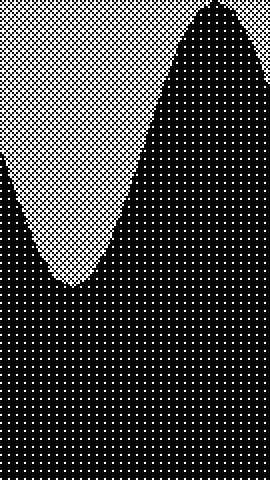

# ghee

[](https://github.com/holofermes/ghee/actions/workflows/ci.yml)

Headless GLSL renderer for small Linux devices. ghee compiles a set of fragment
shaders (a scene), renders them off-screen with GLES2 through DRM/GBM, and hands
the pixels to whatever you point it at: image files on disk, a SPI panel, a live
MJPEG stream in your browser.



The baseline target is the Raspberry Pi VC4 GPU (tested on a Pi Zero 2 W and a
Pi 3 A+), but it runs on newer generation Pis with V3D, and on any desktop Linux
with Mesa.

## A scene in one file

A scene is JSON: an ordered list of passes, each with its own GLSL fragment shader.
This is `bars.scene.json`, one of the bundled examples:

```json
{
  "version": 1,
  "passes": [
    {
      "name": "main",
      "shader": "bars.glsl",
      "arrays": [{ "name": "amplitudes", "size": 16 }]
    }
  ]
}
```

and `bars.glsl` next to it:

```glsl
void main() {
  vec2 uv = v_texCoord;
  int last = amplitudes_size - 1;
  float fi = uv.x * float(last);
  int i0 = int(floor(fi));
  float h = mix(amplitudes_at(i0), amplitudes_at(min(i0 + 1, last)), fract(fi));
  float m = step(uv.y, h);
  gl_FragColor = vec4(mix(vec3(0.04), vec3(0.1, 0.9, 0.4), m), 1.0);
}
```

Optionally, a pass can also carry its GLSL inline in a `"code"` string.

Render it to numbered PNGs:

```
ghee render bars.scene.json -o frame.####.png --frames 60
```

Or open the browser console on the bundled examples and edit the GLSL live:

```
ghee serve --demo
```

`ghee serve <your_scenes_dir>` serves your own scenes instead.

## Install

The ghee C engine needs a compiler, CMake, and the GLES/DRM development headers. On Raspberry Pi OS or Debian:

```
sudo apt install cmake pkg-config libdrm-dev libgbm-dev libegl1-mesa-dev libgles2-mesa-dev libjpeg-dev
```

Now you can install and compile the engine at once:

```
pip install ghee-render
```

Optional extras: `ghee-render[console]` for the browser console,
`ghee-render[drivers]` for the bundled SPI display drivers,
`ghee-render[test]` for the test suite.

If the GL stack is missing at install time the package still installs,
but rendering will ask for a prebuilt engine via `$GHEE_LIB`.

Note that the renderer picks its GPU node automatically, override with
`$GHEE_DRI` or `--dri`.

## How does it work

The pass model is heavily inspired by Shadertoy. Passes render in order, each
one a fragment shader drawing into its own buffer. A pass reads other passes
through numbered channel samplers: a channel bound to an earlier pass sees the
current frame, and a channel bound to the pass itself (or a later one) sees the
previous frame, and the last pass is what reaches the output.

A scene is usually a JSON file. It can also be a Python file, referred to as a
procedural scene, that builds its passes in code, reacts per frame, and feeds
its own data; see [Feeding data](#feeding-data) below.

Every pass's GLSL is compiled with this simple preamble:

```glsl
uniform float time;                 // seconds since start
uniform vec2  resolution;           // buffer size in pixels
varying vec2  v_texCoord;           // 0..1 across the buffer
// gl_FragCoord is remapped to the varying, so ShaderToy
// gl_FragCoord.xy / resolution math is exact

// declared array, e.g. {"name": "amplitudes", "size": 16}:
const int amplitudes_size;          // = 16
float amplitudes_at(int i);         // one element
float amplitudes_sample(float t);   // interpolated, t in 0..1
// arrays are bound as 1xN textures

// per channel: uniform sampler2D iChannel0..N
// per param:   uniform <type> <name>
```

Channels are declared on the pass by `"buffer"` name:

```json
{ "name": "compose", "shader": "compose.glsl", "channels": [{ "buffer": "compose" }] }
```

That pass samples its own previous frame through `iChannel0`:

```glsl
// compose.glsl: everything drawn so far, fading a little each frame
void main() {
  vec3 prev = texture2D(iChannel0, v_texCoord).rgb;
  gl_FragColor = vec4(prev * 0.95, 1.0);
}
```

Params are typed uniforms declared on the pass, with optional range metadata:

```json
{ "params": { "gain": { "type": "float", "value": 0.45, "min": 0, "max": 1, "step": 0.01 } } }
```

which the preamble turns into `uniform float gain;`. The console renders every
param as a slider and updates it live. Types: `float`, `int`, `vec2/3/4`.

## Feeding data

Every array a pass declares gets fed once per frame, no matter what is doing
the rendering. Unfed arrays get an animated sinewave placeholder, which is why
`ghee render` and `ghee serve` animate out of the box.

Driving the renderer yourself, the feed is the callable you pass to
`render()`; it is asked for each declared array name, every frame:

```python
from ghee import load_scene
from ghee.engine import Renderer

scene, _ = load_scene("bars.scene.json")
r = Renderer(320, 240)
r.setup(scene)
frame = r.render(lambda name, size, i=0: my_source(size, i))  # numpy RGB
```

A procedural scene bundles the data source with the scene itself: a `.py` file
with a `SceneController` that builds the passes in code and feeds its own
arrays through `provide()`:

```python
from math import sin

from ghee import ArrayInput, Pass, Scene, SceneController


class Pulse(SceneController):
    def build(self, base):
        return Scene(passes=[Pass(
            name="main",
            code="void main() { gl_FragColor = vec4(vec3(level_at(0)), 1.0); }",
            arrays=[ArrayInput("level", 1)],
        )])

    def provide(self, name, size, frame):
        return [0.5 + 0.5 * sin(frame / 15.0)]
```

`ghee render pulse.py` and `ghee serve` treat it like any other scene.
`examples/spectrum.py` is a bigger one, with a param that the shader and the
Python side both read.

And to preview your data in the web console, map array names to your source:

```python
from ghee.console.server import run

run(arrays={"amplitudes": my_source})  # my_source(size, frame) -> floats
```

## The console

`ghee serve <scenes_dir>` (or `--demo`) starts a small web editor on
`127.0.0.1:8090`: live preview of the running scene, GLSL editing per pass with
compile errors inline, param sliders, pass muting, and a filter picker. Apply
recompiles the running renderer.

Save writes the scene to `<scenes_dir>/modified/<name>.scene.json`. Proper I/O
is on the roadmap.


The console has no authentication and compiles whatever GLSL is posted to it,
so it binds loopback by default. To expose it to your network pass `--host 0.0.0.0`,
do that only on a network you trust.

## Filters

A filter is a named single pass post process that a scene or a host can append
after the scene's own passes:

```json
{ "passes": [ ... ], "filters": ["dither"] }
```

The bundled `dither` is an ordered 4x4 Bayer dither, which is what makes
grayscale scenes readable on 1-bit panels.

## Hardware displays

```
ghee displays                      # list drivers and whether they import here
ghee render scene.json --display st7789
```

The two bundled drivers are reference implementations for the exact panels
this project was built on: `st7789` (135x240 SPI LCD, pins and offsets as
wired on my Pi) and `ssd1306` (128x32 I2C 1-bit OLED). Both live behind the
`[drivers]` extra. For other panels, or the same controllers wired
differently, write a small driver class (subclass `DisplayDriver`, implement
`write(frame)`) and register it through the `ghee.drivers` entry point group;
it gets picked up by name. Making the bundled drivers configurable (size,
pins, offsets) is on the roadmap.

## Tests

```
pip install 'ghee-render[test]'
python -m pytest
```

The render tests need a GPU node and skip cleanly without one. Every bundled
example renders against a committed golden image, compared with a tolerance
that one baseline passes on both desktop Mesa and VC4.

## License

MIT.
