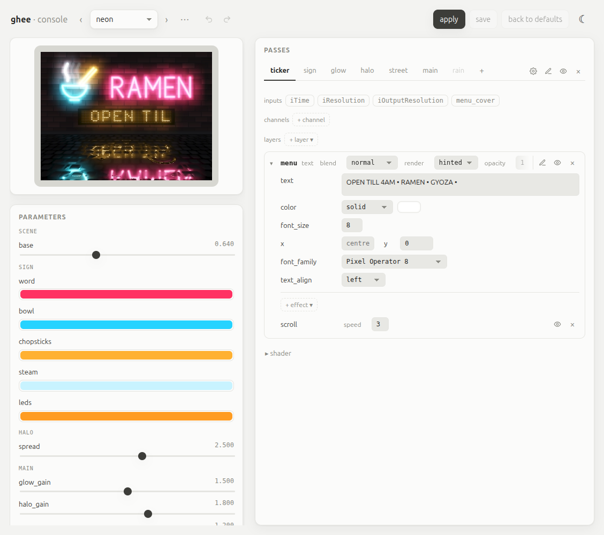
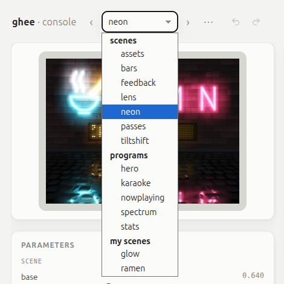
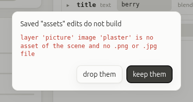
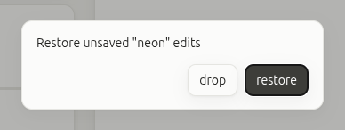

# The console

The console is ghee's web page for a running scene. Use it to watch the
scene, and to change its params, layers and shaders at runtime: a change
shows on the preview at once, and on a screen too when ghee drives one.



To open it and explore the bundled examples, run:

```shell
ghee serve --demo
```

ghee prints the address, and you open it in a browser:

```
ghee console: http://127.0.0.1:8090/ 12 scenes ['assets', 'bars', 'feedback', 'lens', ...] (scenes=..., my scenes=..., preview 320x240 rgba)
```

To open it from your laptop while ghee runs on a Pi, see [From another
computer](#from-another-computer).

## Opening it

| To | Run |
| --- | --- |
| make and edit your own scenes | `ghee serve` |
| browse a folder of scenes | `ghee serve DIR` |
| browse the bundled examples | `ghee serve --demo` |
| work on one scene | `ghee serve glow.scene.json` |
| watch a render that also goes to a display or files | `ghee render SCENE --display kms --serve` |
| watch your Python program | `ghee.open(..., serve=8090)` ([Python](python.md#the-console-from-python)) |

The console listens on port 8090. To use another, pass `--port`. Whatever
you serve, the scene list also shows [your own scenes](#your-scenes).



## What you can change

- **The scene:** pick one from the list.
- **Params:** add, change or remove [params](scenes.md#params).
- **Layers:** add, change or remove [layers](layers.md).
- **Shaders:** edit each pass's GLSL, with compile errors marked on their line.
- **Passes:** change an existing pass.
- **Filters:** add, change or remove a [filter](filters.md).

Click the ↺ beside a value to restore its default, or restore the whole
scene at once.

The preview shows an H264 video when the browser can play it, else an
MJPEG stream. You can turn the preview, pop it out into its own window, or
show it fullscreen.

## Undo and redo

To take back your last change, click the undo arrow beside the scene list,
or press Ctrl+Z (⌘Z on a Mac). To bring it back, click the redo arrow, or
press Ctrl+Shift+Z or Ctrl+Y.

## Your scenes

A scene that you make in the console is a real scene file, in a folder of
its own: `glow/glow.scene.json`, beside a `.glsl` file for each pass. The
folders live in `~/.local/share/ghee/scenes`. To keep them elsewhere, pass
`--my-scenes DIR`, or set `$GHEE_MY_SCENES`. `ghee serve` with no folder
serves them.

In the console you can make a new scene, blank or as a copy of the open
one, and rename or delete one of your own. To add an image or a font to one
of your scenes, upload it from its layer: a `.png`, `.jpg`, `.ttf` or
`.otf` file of up to 32 MiB. The file lands in the scene's folder.

To render one of your scenes without the console, pass its folder to `ghee
render` ([Where ghee finds a scene](scenes.md#where-ghee-finds-a-scene)). A
[program](procedural.md) in a scene's folder behaves the same in the console
as in `ghee render`. To see changes to a scene's files, reload the page for
them to take effect.

## Saving

What Save does depends on whose scene it is.

Your own scene: Save writes your changes into its files, like any editor.

Any other scene, such as a bundled example or a scene in a folder that you
serve: ghee never touches its files. Save keeps only your changes, as
overrides in a sidecar file, in `$XDG_DATA_HOME/ghee/edits`, by default
`~/.local/share/ghee/edits`. You can change this with `--edits-dir DIR`.
Overrides take over the scene's defaults, but with `ghee render` you can
choose to render a scene without overrides with `--original`.

If the scene's files change later, your overrides still apply. The console
asks only where the two clash: keep yours, or take the files'.

If a saved change no longer fits the scene, the console asks whether to
keep it or drop it:



ghee keeps your unsaved changes in a draft file, in `~/.local/state/ghee`
(`--state-dir` to change it). After a restart, reboot or crash, the console
asks whether to restore them or drop them.



In the console, a scene can use only files inside its own folder or in
`$GHEE_ASSETS`. A file given by an absolute path, or by a path that climbs
out with `..`, fails to load there, even though `ghee render` loads it.

## What a program locks

When a [procedural scene](procedural.md) runs, the console locks each param
and layer key set by the procedural scene's program, until the program ends.

## From another computer

By default, the console listens only on `127.0.0.1`, so only the machine
that runs ghee can open it. To open it from another computer, the safest
way is an ssh tunnel, which also gives you the H264 video:

```shell
ssh -L 8090:localhost:8090 pi@raspberrypi.local
```

Then open `http://localhost:8090/` on your computer.

To open it to your network instead, pass `--host 0.0.0.0`, and open one of
the addresses that the console prints when it starts. Over plain `http`
from another computer, the browser shows the MJPEG stream. To use the H264
video, you must use `https` or `localhost`.

Careful: the console has no password, and anyone who reaches it can change
your scenes and run any shader. Open it only on a network you trust.
Uploads stay off on a network until you pass `--allow-uploads`.

To reach a console that listens on loopback through a proxy on the same
machine, such as `tailscale serve`, pass the `Host` names passed by the
proxy to `--allow-hosts`. For example, if `tailscale serve` publishes the Pi
as `raspberrypi.example.ts.net`, run:

```shell
ghee serve --allow-hosts raspberrypi.example.ts.net
```

To set the H264 video's and the MJPEG stream's size and frame rate, see
`ghee serve --help`. To drive the console from a program, see [HTTP
API](http.md).
