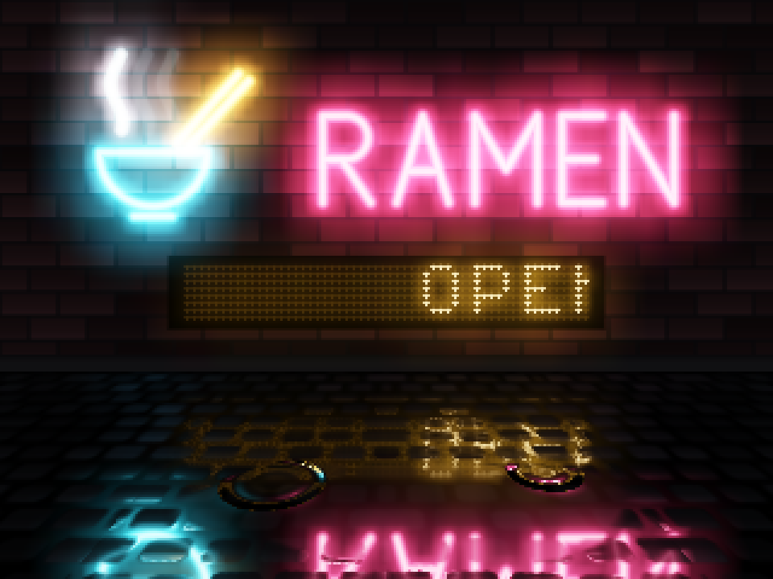
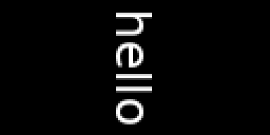
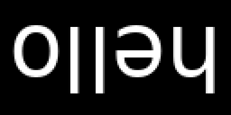

# Outputs and displays

ghee puts each frame on one or more outputs: image files, raw frames on
stdout, an H264 stream, a display (HDMI, or a small panel on SPI or I2C),
and ghee's web console.

A scene is what ghee draws, kept in a file ([Scenes](scenes.md)). For
example, this renders `neon`, a scene bundled with ghee, into sixty PNG
files, `frame.0000.png` to `frame.0059.png`:

```shell
ghee render --demo neon -o frame.####.png --frames 60 --timestep 0.0333
```

Frame 30, shown here at three times its size:



To get the same files on every run, however fast ghee draws, use
`--timestep S`: frame N then shows the scene at N × S seconds. Without it,
each frame shows the scene at the moment ghee draws it.

To render your own scene, give its file in place of `--demo neon`, as in
`ghee render clock.scene.json -o clock.png`.

## Picking an output

| Output | `ghee render` | `ghee serve` | `ghee.open` in Python |
| --- | --- | --- | --- |
| [image files](#image-files) | `-o frame.####.png` | | `screen.save("frame.png")` |
| [raw frames](#raw-frames) | `-o -` | | `screen.pixels()` |
| [an H264 stream](#h264) | `--h264 PATH` | the console's video | the console's video |
| [a display](#hardware-displays) | `--display kms` | `--display kms` | `display="kms"` |
| [the console](#the-console) | `--serve` | always | `serve=8090` |

In Python, `screen` is what `ghee.open` returns ([Python](python.md)).

You can give `ghee render` several outputs at once. This puts a scene on
the connected panel, and also writes each frame to a PNG, until Ctrl-C:

```shell
ghee render --demo bars --display kms -o frame.####.png
```

To set how many frames `ghee render` draws, on any output, use `--frames`.
Without it, image files and raw frames get one frame, and a display, a
stream or the console runs until Ctrl-C. With no display, ghee draws at 320x240. To draw at another size,
use `--size WxH`.

## Image files

To write several frames, put a run of `#` in the file name. ghee replaces
the run with the frame's number: `frame.####.png`. If you ask for more than
one frame and the file name has no `#`, ghee stops with `multiple frames
into one filename`.

To pick the format, end the file name in `.png` or `.jpg`. PNGs are
lossless and stored uncompressed. For smaller files, use `.jpg` with
`--save-opts quality=90`.

Image files are opaque. To keep the scene's transparency, add `--alpha`.

## Raw frames

To pipe frames to a program that reads raw video, use `-o -`. ghee writes
each frame's RGBA bytes to stdout, row by row from the top, with no header.
For a program that reads RGB without alpha, add `--components 3`.

Give the reading program the size that ghee draws at. This pipes 300 frames
of `bars` at 320x240 through ffmpeg into a 5 s `out.mp4`:

```shell
ghee render --demo bars -o - --size 320x240 --frames 300 --timestep 0.0166667 |
  ffmpeg -f rawvideo -pix_fmt rgba -s 320x240 -framerate 60 -i - -pix_fmt yuv420p out.mp4
```

If you keep transparency with `--alpha`, raw frames come premultiplied. For
ffmpeg's `rgba`, which reads them unpremultiplied, add `--alpha
unpremultiplied`.

## H264

To write an H264 stream, use `--h264 PATH`, or `-` for stdout. The file is
a raw H264 stream, not an MP4, so name it `.h264`. This plays a scene in mpv
as it renders:

```shell
ghee render --demo neon --h264 - | mpv -
```

The stream runs at 30 frames a second, and ghee draws it at that pace. To
set another rate, use `--fps`. To write a clip of a set length, use
`--frames`. This writes 5 s of `neon` and copies it into an MP4:

```shell
ghee render --demo neon --h264 neon.h264 --frames 150
ffmpeg -framerate 30 -i neon.h264 -c copy neon.mp4
```

For a sharper stream, raise its target bitrate with `--bitrate`, in bits a
second. For a smaller file, lower it.

A Pi Zero to Pi 4 encodes with its hardware encoder. There, ghee scales a
small panel's stream up by a whole factor, to at least 16384 pixels: a
128x32 panel's stream comes out at 256x64. The panel still shows 128x32.

A Pi 5 or a desktop computer encodes with ffmpeg's libx264. To install it:

```shell
sudo apt install ffmpeg
```

## Hardware displays

To draw on a display, use `--display kms`. `kms`, the Linux kernel's
display system, is its only value, so a bare `--display` does the same.
ghee draws on HDMI, or on an SPI or I2C panel ([Setting up a
panel](#setting-up-a-panel)). To list the connected displays, run
`ghee displays`. On a Pi with a panel and an HDMI screen:

```
kms          /dev/dri/card1 connected, 128x32
kms          /dev/dri/card2 connected, 1280x800
```

`--display kms` takes the first display in that list, here the panel. To
draw on the HDMI screen, pass its card:

```shell
ghee render --demo neon --display kms --dri /dev/dri/card2
```

On HDMI, a running desktop's window manager holds the display, and ghee
stops with an error that starts `cannot take DRM master`. To free it, stop
the desktop (`sudo systemctl stop lightdm` on Raspberry Pi OS), or boot the
Pi to the command line (`sudo raspi-config`). The Linux text console steps
aside by itself.

ghee turns the display off when it ends or a program closes it.

ghee draws at the display's own size. On a large HDMI screen, you can draw
smaller with `--size`, and the display stretches the frame. A panel's size
is fixed: given `--size` with a panel, ghee stops with an error.

In Python, pass the same settings to `ghee.open` as keywords
([ghee.open](python.md#gheeopen)).

### Pace

On a display, ghee draws at the display's own pace. To draw fewer frames,
use `--fps`.

Use `--drop` when the newest frame matters more than every frame, such as
in a scene that follows music. The display then shows the newest frame each
time it's ready, and drops older ones. Set `--fps` too, or ghee draws as
fast as it can and keeps a CPU core busy ([Frames](python.md#frames) has
Python's side).


### Rotate and brightness

If your display is rotated, use `--rotate 90`, `180` or `270`. ghee turns
the frame clockwise on its way to every output. At 90 and 270 the scene
draws with width and height swapped, 64x128 on a 128x64 panel. The same
scene of the word `hello` at 128x64:

| `--rotate 0` | `--rotate 90` | `--rotate 180` |
| --- | --- | --- |
|  |  |  |

To set a panel's brightness, use `--brightness LEVEL`, from 0 to 1. On an
SSD1306, SH1106 or SSD1322, that's the contrast. A backlight that is only
on or off turns off below 0.5 and on from 0.5. On a display with no backlight, such as most HDMI screens,
ghee prints `the display on /dev/dri/card2 has no backlight device` and
draws on. This shows the `stats` scene upside down on an SSD1306, at half
its contrast:

```shell
ghee render --demo stats --display kms --rotate 180 --brightness 0.5
```

## Setting up a panel

The kernel drives SPI and I2C panels through a device tree overlay. To set
one up, run `ghee overlay PANEL`. It prints the `config.txt` lines that the
panel needs, writes any file that those lines need, and says how to install
them. Once the overlay is in, `--display kms` can draw on the panel. This
sets up the Adafruit 1.3" TFT Bonnet, a 240x240 ST7789:

```
$ ghee overlay st7789 --opts width=240,height=240,madctl=0x00,backlight=26
dtoverlay=mipi-dbi-spi,spi0-0,speed=62500000
dtparam=width=240,height=240
dtparam=dc-gpio=25,backlight-gpio=26
dtparam=write-only
wrote panel.bin. Copy it to /lib/firmware/panel.bin, add the lines above to /boot/firmware/config.txt, and reboot
```

And this, a 128x32 SSD1306 at its usual address:

```
$ ghee overlay ssd1306 --opts height=32
dtparam=i2c_arm=on
dtparam=i2c_arm_baudrate=1000000
dtoverlay=ssd1306,height=32,inverted,sequential
add the lines above to /boot/firmware/config.txt, and reboot
```

Pass the panel's options to `--opts` as `key=value` pairs. Pins are BCM
numbers, and `speed` is the bus clock in Hz.

| Panel | Bus | Colours | Options, and their defaults |
| --- | --- | --- | --- |
| `st7789` | SPI | full colour | `width` and `height`, required. `madctl` 0xC0. `dc` 25, `rst` none, `backlight` 22, `speed` 62500000, `x_offset` and `y_offset` 0, `spi_bus` and `spi_device` 0 |
| `ili9341` | SPI | full colour | as `st7789`, with `width` 320, `height` 240, `madctl` 0x28 when wider than tall and 0x48 otherwise, `dc` 25, `rst` 27, `backlight` 18 and `speed` 32000000. `invert=True` for an IPS panel |
| `ssd1306` | I2C | 1-bit | `height` 32 or 64, required. `address` 0x3C, `speed` 1000000 |
| `sh1106` | I2C | 1-bit | `address` 0x3C, `speed` 400000. A 1.3" 128x64 panel |
| `sh1106-spi` | SPI | 1-bit | `spi_device` 0, `dc` 24, `rst` 25, `speed` 4000000 (Waveshare's 1.3inch OLED HAT) |
| `ssd1322` | SPI | 16 levels | `width` 256, `height` 64, `col_offset` 28, counted in columns of 4 pixels. `spi_device` 0, `dc` 24, `rst` 25, `speed` 10000000 |

If an ST7789 or ILI9341 picture comes out upside down, use `--rotate 180`.
If it comes out mirrored, flip a bit in `madctl`, starting from its value in
the table: 0x40 flips the columns, 0x80 the rows. If its colours come out
swapped, flip 0x08. Then run `ghee overlay` again. If the picture comes out
shifted, set `x_offset` and `y_offset` from the board's own docs.

### 1-bit and 16-level panels

A 1-bit panel shows each pixel fully on or off, so grey edges turn ragged
and thin text breaks up. Careful: on a 1-bit panel, set text to `"render":
"mono"` ([Render](layers.md#render)), or bring grey back with a filter
([Filters](filters.md)). To show grey as a pattern of dots, add `dither`.
To get more greys on a panel that takes over 100 frames a second, add `frc`.
To show 241 greys on a 16-level panel, add `frc16`.

## The console

To browse, switch and edit scenes in ghee's [console](console.md), run
`ghee serve`.
To watch one render that also goes to a display or files, add `--serve` to
`ghee render`. Both print the console's address, `http://127.0.0.1:8090/`
by default.

To open the console from another computer, add `--host 0.0.0.0`, and open
the Pi's address on port 8090. Read [Console](console.md) first, on who can
then reach it.

On `localhost` or over `https`, the console shows an H264 video. Over plain
`http` from another computer, it shows a JPEG preview. To set the H264 video's or the JPEG preview's size
and frame rate, see `ghee serve --help`.


Each Pi's own limits, such as the largest frame that it can draw, are on
[Raspberry Pi](pi.md).
