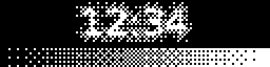
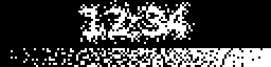
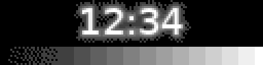
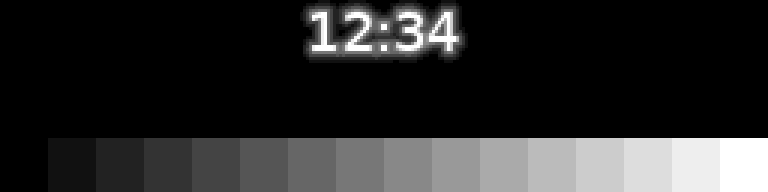

# Filters

A filter is a pass that ghee adds over the finished frame. ghee has three
built in, to improve the look of 1-bit and 16-level panels: `dither`,
`frc` and `frc16`.

To use a filter, add it to the scene's `filters`:

```json
{
  "version": 1,
  "passes": [{ "name": "main", "fragment": "void main() { gl_FragColor = vec4(vec3(uv.x), 1.0); }" }],
  "filters": ["frc"]
}
```

To add one on the command line, use `--filters`, with several names
separated by commas. This draws the `bars` example through `frc` on a
connected panel ([Hardware displays](displays.md#hardware-displays)):

```shell
ghee render --demo bars --filters frc --display kms
```

From Python, give `ghee.Scene` the same list, as in
`ghee.Scene(passes=[...], filters=["frc"])`. In the
[console](console.md), add one with its filter picker.

## Picking a filter

A 1-bit panel, such as the SSD1306 or SH1106, turns each pixel fully on or
off. With no filter, every grey turns black or white. The pictures on this
page show a clock over a grey ramp:


If your screen shows only text, use `"render": "mono"`
([Render](layers.md#render)) and no filter.

### dither

To show grey on a 1-bit panel at any frame rate, add `dither`. It draws grey
as a still pattern of dots. Small letters break up.



### frc

To show soft greys on a 1-bit panel, add `frc`. Each pixel blinks on and
off fast enough to read as grey. It shows up to 16 greys, and holds
steadiest at about 200 frames a second. On a Pi Zero 2 W, an SSD1306 runs
`frc` at about 110 to 130 frames a second on I2C at 1 MHz, the bus speed
that [`ghee overlay ssd1306`](displays.md#setting-up-a-panel) sets.

| Its 16 frames, slowed down | What the eye sees at 200 frames a second |
| --- | --- |
|  |  |

On a slower panel, the darkest greys flicker. To calm them, raise `calm`,
4 by default, and the darkest greys turn into a fixed pattern of dots that
holds still. At 106 frames a second, set `calm` to 8, and at 86, set it to
10. Text of 12 pixels per em then reads as well as at 210 frames a second.
Text of 10 pixels roughens, and text of 8 breaks. To blink fewer greys more
steadily, set `coarse` to 1 for every second grey, or 2 for every fourth.

### frc16

To show greys between the levels of a 16-level panel, such as the SSD1322,
add `frc16`. Each pixel blinks between two neighbouring levels, and the 16
levels become 241 greys. It needs the panel's full rate, about 200 frames a
second on the SSD1322. On a Pi 5, `frc16` takes an SSD1322 from 206 to 200
frames a second.

| No filter, 16 levels | `frc16`, as the eye sees it |
| --- | --- |
|  |  |

## Changing a filter's settings

To start a filter at settings of your own, list it in `filters` as an
object with its `name` and the settings that you change. This `frc` holds
still on a panel that takes about 106 frames a second:

```json
"filters": [{ "name": "frc", "calm": 8 }]
```

On the command line, write the filters in ffmpeg's [filtergraph
syntax](https://ffmpeg.org/ffmpeg-filters.html#Filtergraph-syntax): the
name, `=`, then the settings separated by colons, and a comma between
filters, as in `--filters frc=calm=8:coarse=1,dither`. From Python, give
`ghee.Scene` the same object. In the console, change a setting on the
filter's pass.

To change a setting at runtime from Python, set it as a param:
`screen.set_param("calm", 8)`. When the scene has a param of the same name,
name the filter's pass too: `screen.set_param("calm", 8, in_pass="frc")`
([Python](python.md#opening-a-scene)).

## Your own filter

To write a filter, put one pass in a file named `<name>.filter.json`. Its
shader reads the frame so far as `iChannel0`. This one, `invert.filter.json`,
turns the frame negative:

```json
{
  "name": "invert",
  "fragment": "void main() { vec3 c = texture2D(iChannel0, uv).rgb; gl_FragColor = vec4(1.0 - c, 1.0); }"
}
```

To use it, list its folder in `$GHEE_FILTERS`, with more folders separated by colons:

```shell
GHEE_FILTERS=~/filters ghee render --demo bars --filters invert -o invert.png
```

A filter file also takes `params`, `channels` and `assets`, as a pass does
([Scenes](scenes.md#passes)). ghee looks for a filter's asset files beside
the filter file.
