# Layers

Layers let you add text, images, video and shapes on top of a
[scene](scenes.md). You write layers in the scene's JSON, from Python, or in
the console. You can also read a text layer's words, an image, or a camera's
frames in the scene's shaders, and draw them your own way ([Layers in a
shader](#layers-in-a-shader)).

For example, this scene's shader paints the frame black. A text layer writes
`hello` to fit the available space, and a shape layer lays an orange bar
along the bottom:

```json
{
  "version": 1,
  "passes": [{
    "name": "main",
    "fragment": "void main() { gl_FragColor = vec4(0.0, 0.0, 0.0, 1.0); }",
    "layers": [
      { "name": "title", "text": "hello" },
      { "name": "bar", "shape": "rect", "y": 56, "height": 8, "color": "orange" }
    ]
  }]
}
```

And you can render it to a PNG:

```shell
ghee render hello.scene.json -o hello.png --size 128x64
```


You can do the same from Python with a `draw()` block. Each call in the block
is one layer, and its keywords are the layer's keys
([Python](python.md#drawing)):

```python
import ghee

screen = ghee.open(width=128, height=64)
with screen.draw() as d:
    d.text("hello", name="title")
    d.rect(name="bar", y=56, height=8, color="orange")
screen.save("hello.png")
```

## Every layer

There are four kinds of layer: text, image, video and shape. A pass draws its
layers in order, the last on top.

Positions and sizes are pixels of the pass, from its top left corner, y down.

| Key | Values | Default | What it changes |
| --- | --- | --- | --- |
| `name` | letters, digits and `_`, a letter first ([Names](scenes.md#names) has the rules) | required | the layer's name, to change it later and to read it in a shader |
| `visible` | `true`, `false` | `true` | whether the layer draws |
| `x`, `y` | pixels | centred (0 for a line) | where the layer's top left sits, and a circle's centre. A line's points move by `x`, `y` |
| `color` | a colour | white (no tint on an image or a video) | the layer's colour |
| `opacity` | 0 to 1 | 1 | how much of the layer shows |
| `blend` | `normal`, `add`, `multiply`, `screen` | `normal` | how the layer mixes with what's under it |

Set `color` to any [colour](scenes.md#colours). `"transparent"` draws nothing:
set a text's colour to `"transparent"`, for example, to show only its effects.

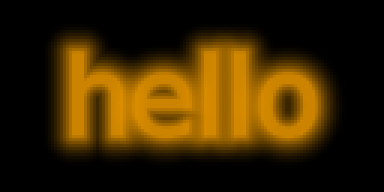

Use `add`, `multiply` and `screen` as you would in an image editor. An orange
layer over a black-to-white gradient:

| `normal` | `add` | `multiply` | `screen` |
| --- | --- | --- | --- |
| 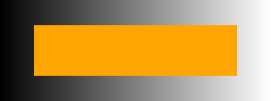 |  | 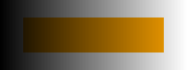 | 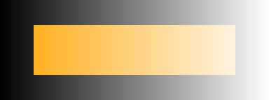 |

### Assets

An asset is a file on disk, or a capture device, that you declare in the
scene's `assets`, to use in its layers and shaders. For example, these declare
a bold font, a picture and a camera:

```json
"assets": {
  "bold": { "file": "DejaVuSans-Bold.ttf" },
  "wifi": { "file": "wifi.png", "sampling": "linear" },
  "cam": { "device": "/dev/video0" }
}
```

Then use `"font_family": "bold"` on a text layer, `"image": "wifi"` on an
image layer, and `"video": "cam"` on a video layer.

ghee looks a relative path up in the scene's folder, or in the working
directory for `ghee.open` with no scene file. Set `$GHEE_ASSETS` to a
colon-separated list of paths to add more folders to search.

## Text layers

Use a text layer to write words in a font. For example, this one writes
`cpu 12%` at 12 pixels per em in the top left corner:

```json
{ "name": "cpu", "text": "cpu 12%", "font_size": 12, "x": 0, "y": 0 }
```

| Key | Values | Default | What it changes |
| --- | --- | --- | --- |
| `text` | words. A newline starts a new line | required | the words |
| `font_size` | pixels per em | the largest size that fits | the size of the letters |
| `font_family` | a font asset, a `.ttf` or `.otf` path, one of ghee's [fonts](#fonts), or a list of these | `"DejaVu Sans"` | the font |
| `text_align` | `left`, `center`, `right` | `left` | how lines of different lengths line up |
| `render` | `auto`, `hinted`, `mono`, `mtsdf`, `slug` | `auto` | how the letters turn into pixels ([Render](#render)) |
| `color` | a colour, or a gradient | white | the letters' colour |

To right-align words, or centre them on a point, get their width and height in
pixels with `screen.measure("cpu 12%", font_size=12)`.

If you don't set `font_size`, ghee picks the largest size that fits between
the words' position and the pass's edges, inside a 5% margin. Words that
change, such as a clock, then change size as they change: give them a
`font_size` to keep it steady. A text with the [`scroll` effect](#effects)
fits its height only, since it moves sideways.

You can also colour the letters with a gradient:

```json
"color": { "from": "red", "to": "yellow", "angle": 90 }
```

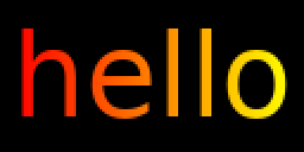

Set `angle` as in CSS: 0 runs up, 90 right, and 180, the default, down.

### Fonts

ghee carries two fonts. DejaVu Sans is the default. Pixel Operator 8 is a
pixel font, crisp at 8, 16, 24 px and every other multiple of 8, and a Pixel
Operator 8 text with no `font_size` fits to one of those. Its letters draw
`hinted` at any size, unless the layer sets a `render`. For any other font,
bold included, give its `.ttf` or `.otf` file as an [asset](#assets), or its
path in `font_family`.

You can also give `font_family` a list. Each character then comes from the first
font in the list that has it, and the size and render follow the first font.
This one draws in the pixel font, and takes any character that it lacks
from DejaVu Sans:

```json
"font_family": ["Pixel Operator 8", "DejaVu Sans"]
```

To draw emoji in colour, install the Noto Color Emoji font
(`sudo apt install fonts-noto-color-emoji`). A character that no font in the
list has, or an emoji without that font, draws as an empty box:

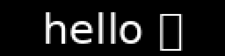

If letters draw as yellow and black striped boxes, ghee hit a text problem,
such as a font that failed to load. Look on stderr for the reason:

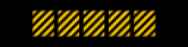

### Effects

You can add effects to a text layer. Each effect is a key holding its settings,
and `{}` takes the defaults:

```json
{ "name": "title", "text": "hello", "glow": {}, "wave": {} }
```

All effects' sizes are in em, and all shapes' sizes are in pixels.

To turn an effect off and keep its settings, set `"visible": false` inside it.
The console shows every effect's settings.

| Effect | What it does | |
| --- | --- | --- |
| `text_shadow` | a soft shadow behind the letters | 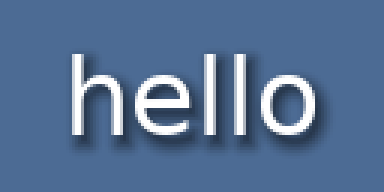 |
| `glow` | light around the letters | 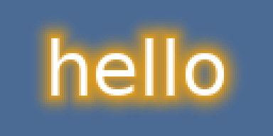 |
| `text_stroke` | an outline around each letter | 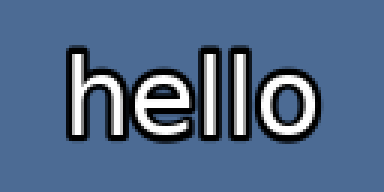 |
| `karaoke` | fills the letters in a second colour up to `sung` letters, and lifts the one being sung | 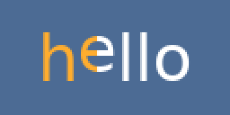 |
| `wave` | bobs the letters up and down | 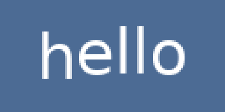 |
| `scroll` | moves the words from the right edge to the left, in a loop |  |
| `blink` | shows and hides the layer | 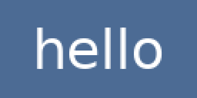 |

## Image layers

Use an image layer to draw a `.png` or `.jpg`, from its path or from an
[asset](#assets). This one puts `wifi.png` 16 pixels wide in the top right
corner of a 128x32 panel, tinted orange:

```json
{ "name": "wifi", "image": "wifi.png", "x": 112, "y": 0, "width": 16, "color": "orange" }
```

And the same in Python: `d.image("wifi.png", x=112, width=16, color="orange")`.

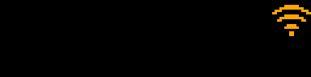

| Key | Values | Default | What it changes |
| --- | --- | --- | --- |
| `image` | a `.png` or `.jpg` path, or an image asset | required | the picture |
| `width`, `height` | pixels | the image's own size | its size. Give one and the other keeps the aspect |
| `color` | a colour | no tint | a tint over every pixel |

When ghee draws an image bigger than it is, each of its pixels becomes a crisp
block, like pixel art. For smooth scaling, declare the image as an asset with
`"sampling": "linear"`:

| as a path | as an asset with `"sampling": "linear"` |
| --- | --- |
| 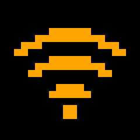 |  |

## Video layers

Use a video layer to show a camera, or any capture device that streams MJPEG
or YUYV, by its path or as an [asset](#assets). This one shows a USB camera
as large as fits the pass:

```json
{ "name": "camera", "video": "/dev/v4l/by-id/usb-Example_Camera-video-index0" }
```

| Key | Values | Default | What it changes |
| --- | --- | --- | --- |
| `video` | the path of a capture device, or a video asset | required | the device |
| `width`, `height` | pixels | the largest size that fits the pass | its size. Give one and the other keeps the aspect |
| `color` | a colour | no tint | a tint over every pixel |

Name a device by its link in `/dev/v4l/by-id` where the system makes one: the
link stays the same across boots, and when the camera moves to another port.
A path such as `/dev/video0` works too. In the console, `+ layer` offers each
capture device of the machine by its name.

ghee streams the device's smallest mode that covers the size the video draws
at. On a Pi Zero to Pi 4, the Pi's hardware decoder decodes each MJPEG frame
and scales it to that size, and the CPU never touches its pixels: on a Pi
Zero W, a 1920x1080 camera took about 3 ms of CPU a frame. Elsewhere, and
with `--video-decoder cpu`, the CPU decodes the frames, an MJPEG frame at a
half, a quarter or an eighth of its size when that still covers it. A camera
with a mode near the size you draw at costs the least there: on a Pi Zero W,
one 1920x1080 MJPEG frame takes about 110 ms of CPU at an eighth of its size.

Careful: the Pi's decoder needs GPU memory. Set it in `config.txt` itself,
`gpu_mem=128` for a 1920x1080 camera, measured on a Pi Zero W: the Pi reads
`gpu_mem` before it boots, and never from a file that `config.txt` includes.
At the default 64 MB, the first 1920x1080 frame hangs the GPU's firmware,
and ghee's H264 and JPEG encoders stop with it until a reboot. Where you
can't raise it, pass `--video-decoder cpu`.

When the device is missing, or stops, the video draws black, and a small
grey `no camera` shows for 2 seconds in every 10, at another spot each time,
so an OLED panel keeps no pixel lit. stderr and `video_errors` in
[`/stats`](http.md#stats) say why. ghee tries the device again every second,
and the picture comes back with it.

## Shape layers

To draw a rect, a line or a circle, use a shape layer with `"shape"` set to
`"rect"`, `"line"` or `"circle"`. These draw a progress bar with round ends
along the bottom of a 128x32 panel, a lime line above it, and an orange dot
at the right:

```json
"layers": [
  { "name": "frame", "shape": "rect", "x": 0, "y": 24, "width": 128, "height": 8,
    "color": "transparent", "border_radius": 4, "border": { "width": 1, "color": "white" } },
  { "name": "fill", "shape": "rect", "x": 2, "y": 26, "width": 60, "height": 4,
    "border_radius": 2 },
  { "name": "scope", "shape": "line", "color": "lime",
    "points": [[0, 12], [16, 4], [32, 16], [48, 8], [64, 18], [80, 2], [96, 12]] },
  { "name": "dot", "shape": "circle", "x": 114, "y": 11, "radius": 8, "color": "orange" }
]
```

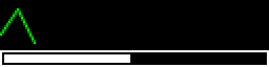

| Key | Values | Default | What it changes |
| --- | --- | --- | --- |
| `width`, `height` | pixels | the pass's own | a rect's size |
| `border` | `width`, `color` and `visible` | no border, and `width` 1 and white once given | an outline inside a rect's or a circle's edge |
| `border_radius` | pixels | 0 | a rect's corners. Half the shorter side rounds the ends |
| `points` | two or more `[x, y]` | required | the pixels that a line runs through |
| `stroke_width` | pixels | 1 | a line's thickness |
| `radius` | pixels | the largest circle that fits | a circle's size around its centre, `x`, `y`, as SVG's `cx`, `cy` |

In Python, use `d.rect()` for a rect, `d.circle((x, y), radius)` for a circle
around `(x, y)`, `d.line((x0, y0), (x1, y1))` for a line, and `d.lines(points)`
for a line through every point.

## Render

Use `render` to pick how a text layer's letters turn into pixels:

| Render | What it draws | Use it for |
| --- | --- | --- |
| `auto` | `hinted` below 128 px per em, `mtsdf` from 128 up | most text |
| `hinted` | letters fitted to the pixel grid, with grey edges | small text |
| `mono` | letters fitted to the pixel grid, every pixel fully on or off | a 1-bit panel |
| `mtsdf` | smooth edges at any size | large text, and text that moves by less than a pixel |
| `slug` | exact edges at any size, from the font's curves ([Slug](https://github.com/EricLengyel/Slug)). It draws no shadow, glow or stroke | very large text |

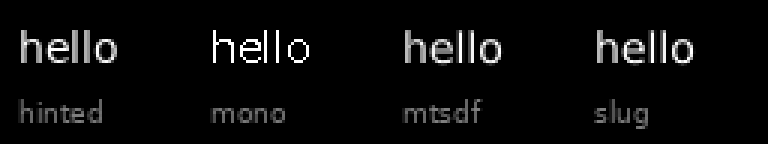

Careful: on a 1-bit panel such as the SSD1306, set `"render": "mono"`, or
bring grey back with a [filter](filters.md).

## Layers in a shader

You can read a text layer's words, any image asset and any video asset in a
pass's shader, and draw them your own way.

### Text in a shader

To read a text layer's words in a shader, use the two GLSL names that it gives
every pass:

| GLSL name | What it holds |
| --- | --- |
| `float <name>_cover(vec2 p, float px)` | how much the words cover the point `p`, 0 to 1. `p` is in em, from the top left of the words, y down |
| `vec2 <name>_size` | the words' width and height, in em |

Both follow the layer's `text`, `font_family` and `text_align`. The layer's
other keys change only how the layer draws.

A visible layer still draws on top of the pass. When the shader draws the
words itself, hide the layer with `"visible": false` so they draw once:

```json
{ "name": "main", "fragment": { "file": "title.glsl" },
  "layers": [{ "name": "title", "text": "hello", "visible": false }] }
```

`title.glsl` draws the words white on black, centred, at 48 pixels per em:

```glsl
void main() {
  float px = 48.0;
  vec2 at = vec2(gl_FragCoord.x, iResolution.y - gl_FragCoord.y);
  vec2 p = (at - 0.5 * (iResolution.xy - title_size * px)) / px;
  gl_FragColor = vec4(vec3(title_cover(p, px)), 1.0);
}
```

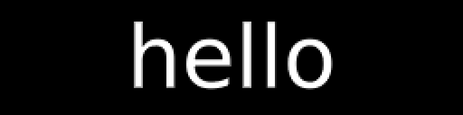

Use `p` to place and size the words: dividing the pixel position by 48 makes
one em 48 pixels. `_cover` takes `p` y down, as a layer counts, so `at` counts
the pixel from the top left. Pass the same 48 as `_cover`'s second
argument, and each edge stays one pixel soft.

### Images in a shader

To read an image asset in a shader, use the two GLSL names that it gives
every pass: `<name>_tex`, a `sampler2D`, and `<name>_size`, its width and
height in pixels. The texture holds the image the right way up, so
`texture2D(wifi_tex, uv)` stretches it over the pass. This pass tiles the
`wifi` picture across the frame:

```json
"assets": { "wifi": { "file": "wifi.png" } },
"passes": [{ "name": "main", "fragment": { "file": "tile.glsl" } }]
```

```glsl
void main() {
  gl_FragColor = texture2D(wifi_tex, fract(gl_FragCoord.xy / wifi_size));
}
```

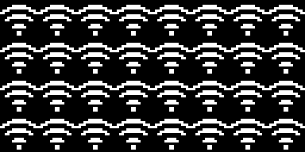

A shader reads an asset in crisp blocks too. To read it smoothly, set
`"sampling": "linear"` on the asset.

### Videos in a shader

A video asset gives every pass the same two names, `<name>_tex` and
`<name>_size`, which hold the newest frame of its device the right way up.
`<name>_size` is the frame's size as ghee decodes it, which can be smaller
than the device's. A video reads smoothly. This pass shows the `cam` asset in
grey:

```json
"assets": { "cam": { "device": "/dev/video0" } },
"passes": [{ "name": "main", "fragment": { "file": "grey.glsl" } }]
```

```glsl
void main() {
  vec3 c = texture2D(cam_tex, uv).rgb;
  gl_FragColor = vec4(vec3(dot(c, vec3(0.299, 0.587, 0.114))), 1.0);
}
```

## Changing a layer at runtime

From Python, open the scene with `ghee.open`, and use `screen.layers` to
change a layer before the next frame:

```python
screen = ghee.open("hello.scene.json", width=128, height=64)
screen.layers.title.text = "bye"
screen.layers.bar.color = "red"
screen.frame()
```

Change an effect's settings the same way:
`screen.layers.title.glow.strength = 0.4`. You can also change these values from the [console](console.md), a
[procedural scene](procedural.md) or `POST /set` ([HTTP API](http.md)). Set `x`,
`y`, `color`, a rect's size or a circle's radius to `None` to put it back to
its default. To read a key, read it the same way: `screen.layers.title.x`
gives its value, or None at its default.

Most changes show on the next frame, such as position, colour or opacity.
Changing a key such as `font_size`, or adding an effect, makes ghee build the
layer again, which can take a few frames on a Pi Zero to Pi 3.
