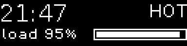
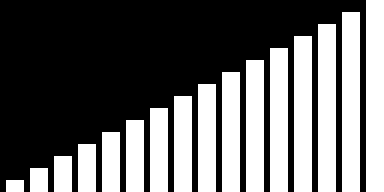
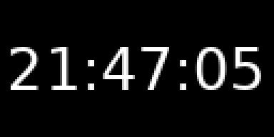

# Python

The `ghee` Python package lets you draw on a screen from your own program, or
write a scene that the `ghee` command renders. You can install both the Python
package and the `ghee` command from PyPI, as
[`ghee-render`](https://pypi.org/project/ghee-render/), and
[Install](../README.md#install) has more.

For example, this program opens a 128x64 screen in memory, draws `hello` on
it, and saves the frame as a PNG:

```python
import ghee

screen = ghee.open(width=128, height=64)
with screen.draw() as d:
    d.text("hello", color="orange", glow={})
    d.line((8, 56), (120, 56), color="orange")
screen.save("hello.png")
```


To draw directly to a connected display instead, use
`ghee.open(display="kms")`: HDMI, or a panel on SPI or I2C, set up with its
device tree overlay ([Hardware displays](displays.md#hardware-displays)).

## Two ways

Use `ghee.open` when ghee is one part of your program, such as a logger that
also shows its readings. Your program runs its own loop, and draws when it
wants. To feed a megabyte or more each frame, use `ghee.open`: it takes less
CPU than a Python scene.

Write a [Python scene](#python-scenes) for ghee to run the way it runs a
[scene](scenes.md) file. `ghee render` puts it on a display or into image
files, and `ghee serve` lists it in the [console](console.md) beside your
other scenes, to switch between them. A scene file holds fixed values. A
Python scene computes its own each frame, such as the time.

## Drawing

To draw a frame, open a `with screen.draw() as d:` block, and make one call
for each [layer](layers.md), later calls on top:

| Call | What it draws |
| --- | --- |
| `d.text(words)` | words ([Text layers](layers.md#text-layers)) |
| `d.image(image)` | a `.png` or `.jpg` file, an image asset, a Pillow image, or a numpy array of HxWx3 or HxWx4 `uint8` ([Image layers](layers.md#image-layers)) |
| `d.rect()` | a box, or the whole screen with no `width` and `height` ([Shape layers](layers.md#shape-layers)) |
| `d.circle((x, y), radius)` | a filled circle of `radius` pixels around (x, y) ([Shape layers](layers.md#shape-layers)) |
| `d.line((x0, y0), (x1, y1))` | a line between two points |
| `d.lines(points)` | a line through a list of (x, y) points |

When the block ends, ghee renders the frame and shows it, as `screen.frame()`
does ([Frames](#frames)).

Pass a layer's keys to its call as keywords, such as `x`, `y`, `color` and
`font_size`. [Layers](layers.md) lists them. `x` and `y` place the layer's top
left corner, in pixels from the screen's top left, y down. To turn on an
effect such as `glow`, pass it a dict of its own keys, or an empty dict for
its defaults: `glow={}`.

The layers stay from frame to frame, so a blink or a scroll keeps moving.
ghee knows each call by its line of code, and each frame's calls state the
whole picture. A key that a call leaves out takes its default, or the value
you gave it in the [console](#the-console-from-python). A call
that your code skips in a frame takes its layer away, and the other calls
keep theirs, names included. When the skipped call runs again, it adds a new
layer, and its effects start over.

This loop shows the machine's load on a 128x32 SSD1306, and the panel
gives the screen its size. The SSD1306 is a 1-bit panel, so the text draws
in `mono`, every pixel on or off. The loop draws the time, the load, a bar
that fills with the load, and a HOT that blinks twice a second above 90%.
`fps=10` holds the loop to ten frames a second:

```python
import os
import time

import ghee

screen = ghee.open(display="kms", fps=10)
while True:
    load = os.getloadavg()[0] / os.cpu_count()
    with screen.draw() as d:
        d.text(time.strftime("%H:%M"), x=0, y=0, font_size=16, render="mono")
        d.text(
            f"load {load:.0%}",
            x=0,
            y=20,
            font_size=8,
            font_family="Pixel Operator 8",
            render="mono",
        )
        d.rect(
            x=64,
            y=20,
            width=64,
            height=8,
            color="transparent",
            border={"width": 1, "color": "white"},
        )
        d.rect(x=66, y=22, width=60 * min(load, 1), height=4)
        if load > 0.9:
            w, _ = screen.measure("HOT", font_size=12)
            d.text(
                "HOT", x=128 - w, y=0, font_size=12, render="mono", blink={"rate": 2}
            )
```

At 95% load:



Effects that move, such as `blink`, `scroll` and `wave`, keep their pace while
your loop draws four frames a second or more. In a slower loop, each frame
moves them a quarter second.

Use `name=` to name the layer of a call, as the console shows it. Without it,
ghee names a new layer after its call, `text`, then `text2`, and so on. Two
calls with the same name in a frame raise ValueError.

To draw a layer of the scene, pass its name. A key that the call leaves out
then keeps the value you gave it in the console, else the scene's.

Use `screen.measure("HOT", font_size=12)` to get the width and height of words
in pixels before you draw them, as for HOT above. Leave out `font_size` to
measure them at the size that fits the screen.

## Opening a scene

You can also open a [scene](scenes.md) with `ghee.open`: a path to a
`.scene.json`, a dict, the JSON text of a scene, or a
[`ghee.Scene`](#building-a-scene-in-python). This opens the bars scene from
[Arrays](scenes.md#arrays), feeds it a ramp, and draws a frame:

```python
import ghee

screen = ghee.open("bars.scene.json", width=128, height=64)
screen.feed("levels", [(i + 1) / 16 for i in range(16)])
screen.frame()
screen.save("ramp.png")
```



| Call | What it changes, from the next frame |
| --- | --- |
| `screen.feed(name, values)` | the numbers of an [array](scenes.md#arrays) |
| `screen.set_param(name, value)` | a [param](scenes.md#params) |
| `screen.layers.title.x = 10` | a key of the layer `title` ([Changing a layer at runtime](layers.md#changing-a-layer-at-runtime)) |

`feed` takes a list of floats, or a buffer such as a numpy array. Bytes, from
`bytes` or a numpy `uint8` array, become 0 to 1: each byte is divided by 255.
On a Pi 0 to 3, an array stores only bytes, so floats outside 0 to 1 clamp. On
a Pi 4 or 5, or a desktop, an array stores true floats, with no clamping.

Use `set_param` to set a param of the scene, and `in_pass="blur"` to set the
param of its [pass](scenes.md#passes) `blur`.

Use `layers` to change a layer's keys at runtime, such as `x`, `color`,
`text` or `font_size`. Use `list(screen.layers)` to get the names of the
layers.

## ghee.open

| Key | Values | Default | What it changes |
| --- | --- | --- | --- |
| `scene` | a path, a dict, JSON text, a `ghee.Scene` | none: a black frame | the scene |
| `display` | `"kms"` | none | `"kms"` draws on the connected display |
| `width`, `height` | pixels, both or neither | 320x240 | the frame's size in memory. With a display, the display's own size wins, and `width` and `height` are ignored |
| `rotate` | `0`, `90`, `180`, `270` | `0` | turns the frame clockwise. At 90 and 270 you draw at the size turned, 32x128 on a 128x32 panel |
| `fps` | frames a second | none | holds the loop to at most this many frames a second |
| `drop` | `True`, `False` | `False` | `True` lets the display skip to the newest frame ([Frames](#frames)) |
| `timestep` | seconds a frame | none: the clock | fixes the time between frames, so a render repeats exactly |
| `alpha` | `True`, `"premultiplied"`, `"unpremultiplied"`, `False` | `False` | keeps the transparency drawn by the scene ([Frames](#frames)) |
| `serve` | a port, or `(host, port)` | none | serves the [console](#the-console-from-python) |
| `stream_max` | pixels, or a share from 0 to 1 | the frame's size | caps the size of the console's video |
| `opts` | `{"rgb565": True}` | none | 16-bit colour on the display, as `ghee render --rgb565` |
| `dri` | a device in `/dev/dri` | `$GHEE_DRI`, else the first that opens | which GPU, as `ghee render --dri` |
| `base_dir` | a folder | the working directory | where a dict, JSON text or a `ghee.Scene` finds its files, and the files that drawing calls name ([Assets](layers.md#assets)) |
| `verbose` | `True`, `False` | `False` | `True` prints what ghee opened |

## Frames

Each frame has a tick: its number, its time, and what the console changed.
`screen.frame()` draws a frame and returns its tick, and a `screen.draw()`
block holds it as `d.tick`:

| Tick | What it holds |
| --- | --- |
| `tick.frame` | the frame's number, from 0 |
| `tick.time` | seconds since the first frame |
| `tick.dt` | seconds since the tick before |
| `tick.params` | the params that the [console](#the-console-from-python) changed since the tick before, as a dict such as `{"speed": 2.0}`. The first tick holds every param |

You can use `screen.skip()` to keep the last frame on the display.

On a display, `frame()` waits for the display, so your loop runs at the
display's pace. To slow it down, use `fps`.

Use `drop=True` when your loop must not wait for the display, such as a loop
that also reads a sensor or follows music. `frame()` then returns at once, and
the display shows the newest frame each time it's ready, dropping any older
one still waiting. Set `fps` too, or the loop runs as fast as it can and keeps
a CPU core busy.

You can read the frame back:

| Call | What it gives |
| --- | --- |
| `screen.pixels()` | bytes, RGBA for each pixel, row by row from the top |
| `screen.image()` | a Pillow image. It needs Pillow |
| `screen.save("frame.png")` | a `.png` or `.jpg` file. A run of `#` in the name takes the frame's number |

On a display, these raise RuntimeError.

With `alpha=True`, ghee keeps the transparency drawn by the scene.
`pixels()` gives the raw frame, premultiplied as rendered, and `image()` and
`save()` give it unpremultiplied. A half-transparent orange pixel reads
(128, 64, 0, 128) from `pixels()`, and (255, 128, 0, 128) from `image()` and
`save()`. To get the same form from `pixels()` and `image()`, set
`alpha="premultiplied"` or `alpha="unpremultiplied"`. With
`alpha="premultiplied"`, `image()` gives a Pillow image in mode `RGBa`,
Pillow's name for premultiplied RGBA, and `save()` raises ValueError, since
a PNG holds alpha unpremultiplied.

`screen.brightness` sets a display's brightness, from 0 to 1.

Set `screen.blank = True` to turn the display off, such as to rest an OLED
between uses, and `False` to light it again. While the display is off,
`frame()` draws nothing.

To close the screen, call `screen.close()`, or open it in a
`with ghee.open(...) as screen:` block.

## Running as a service

To keep a program running for months, such as a status screen, start it
from a systemd user unit. Save this as
`~/.config/systemd/user/status.service`:

```ini
[Unit]
Description=status screen

[Service]
ExecStart=/home/pi/status/.venv/bin/python /home/pi/status/status.py
Restart=on-failure

[Install]
WantedBy=default.target
```

This unit runs the program with the Python of its venv. With ghee from the
deb, run it with the system Python instead:
`ExecStart=/usr/bin/python3 /home/pi/status/status.py`.

Start it now and at every boot, also before you log in:

```shell
systemctl --user enable --now status
sudo loginctl enable-linger $USER
```

`systemctl --user stop status` sends SIGTERM. Python's default for SIGTERM
ends the program without running its `finally` blocks or leaving its `with`
blocks, so the screen never closes. To close it, turn SIGTERM into
SystemExit at the top of your program:

```python
import signal
import sys

signal.signal(signal.SIGTERM, lambda *_: sys.exit(0))
```

When the screen closes, ghee turns the display off.

## Python scenes

A Python scene is a [procedural scene](procedural.md) written in Python, a
script that ghee runs in place of a scene file.

To write one, put `@ghee.tick` on a function: ghee runs it before each frame.
This one, `clock.py`, draws the time:

```python
#!/usr/bin/env -S uv run --script
# /// script
# dependencies = ["ghee-render==0.5.0"]
# ///
import time

import ghee


@ghee.tick
def clock(tick):
    with ghee.draw() as d:
        d.text(time.strftime("%H:%M:%S"))


ghee.run()
```

Its first four lines let [uv](https://docs.astral.sh/uv/) run the script with
`ghee-render` pinned to your ghee's version (`ghee --version`).

To render one frame of it into `clock.png`:

```shell
chmod +x clock.py
ghee render clock.py -o clock.png --size 128x64
```



You can also run the script on its own: `./clock.py` draws on the first
connected display found, and it takes the same flags as `ghee render`, which
you can list with `./clock.py --help`.

| Call | What it does |
| --- | --- |
| `ghee.run(scene)` | runs a scene, given as `ghee.open` takes it ([Opening a scene](#opening-a-scene)), or a black frame with none |
| `@ghee.tick` | runs the function before each frame, with the frame's tick |
| `@ghee.feed("levels")` | runs the function before each frame, with the tick, and feeds what it returns to the array `levels`. None leaves the array as it is |
| `ghee.draw()` | in a tick, a `with` block for this frame's calls ([Drawing](#drawing)) |
| `ghee.layers`, `ghee.set_param`, `ghee.measure` | in a tick, as a screen's |
| `ghee.skip()` | in a tick, keeps the last frame on the display |
| `ghee.render_size()` | the frame's width and height, known before `ghee.run` |
| `ghee.args([...])` | the script's own [arguments](#arguments) |

### Arguments

To give the script arguments of its own, declare them with `ghee.args`, which
returns their values. This `clock.py` takes `--no-seconds`:

```python
#!/usr/bin/env -S uv run --script
# /// script
# dependencies = ["ghee-render==0.5.0"]
# ///
import time

import ghee

args = ghee.args([ghee.Arg("seconds", "bool", True, "show the seconds")])
form = "%H:%M:%S" if args.seconds else "%H:%M"


@ghee.tick
def clock(tick):
    with ghee.draw() as d:
        d.text(time.strftime(form))


ghee.run()
```

Then run it with:

```shell
./clock.py --no-seconds
```

Through `ghee render`, put the script's arguments after `--`
([Procedural scenes](procedural.md)).

Declare each argument with `ghee.Arg(name, type, default, help)`, in one of
these types:

| Type | Takes |
| --- | --- |
| `string` | text |
| `int` | a whole number |
| `float` | a number |
| `bool` | `--name`, or `--no-name` |
| `size` | `WxH`, or a share of the frame: `full`, `half`, `quarter`, `eighth` or `sixteenth`. Its value is `(w, h)` in pixels |

## The console from Python

To serve the [console](console.md) from `ghee.open`, pass `serve=8090` and
open `http://127.0.0.1:8090/`. ghee logs the address at INFO on the `ghee`
logger of Python's `logging`. The console locks each param and layer key
that your code sets. In a drawing, those are the keys that each call
passes. Leave a key out to tune it in the console, and your value stays
from frame to frame. The console changes the layers' looks and the params'
values: your program owns its passes, its shaders, its params' settings and
its assets.

## Building a scene in Python

Use `ghee.Scene` and its parts to build a scene in memory, and pass it to
`ghee.open` or `ghee.run`. Each class stands for one object of the scene
file, and takes its keys as keywords:

| Class | Writes | Its keys |
| --- | --- | --- |
| `ghee.Scene(passes, ...)` | the scene | [The scene file](scenes.md#the-scene-file) |
| `ghee.Pass(name, fragment, ...)` | a pass, its GLSL in `fragment` | [Passes](scenes.md#passes) |
| `ghee.Param(name, type, value, ...)` | a param | [Params](scenes.md#params) |
| `ghee.ArrayInput(name, size)` | an array | [Arrays](scenes.md#arrays) |
| `ghee.Channel(buffer)` | a channel | [Channels](scenes.md#channels) |
| `ghee.Asset(name, file, ...)` | an asset | [Assets](layers.md#assets), [Data files](scenes.md#data-files) |
| `ghee.Layer(name, ...)` | a layer | [Layers](layers.md) |

Give `ghee.Layer` its `image` as you give `d.image` one: a `.png` or `.jpg`
file, an image asset, a Pillow image or a numpy array.

In this scene, a `color` param `ink` holds orange, and the shader paints it from
the top down to black. `uv`, which ghee gives every shader, runs from 0 at the
bottom to 1 at the top ([Built-in names](scenes.md#built-in-names)). A text
layer writes `hello` over it with a shadow:

```python
import ghee

scene = ghee.Scene(
    params=[ghee.Param("ink", "color", "orange")],
    passes=[
        ghee.Pass(
            "main",
            "void main() { gl_FragColor = vec4(ink * uv.y, 1.0); }",
            layers=[ghee.Layer("title", text="hello", text_shadow={})],
        )
    ],
)
screen = ghee.open(scene, width=128, height=64)
screen.frame()
screen.save("scene.png")
```


## luma.oled and Pillow calls in ghee

Each call, and the ghee call that draws the same:

| luma.oled and Pillow | ghee |
| --- | --- |
| `device = ssd1306(i2c(port=1, address=0x3C))` | `screen = ghee.open(display="kms")`, with the panel set up ([Hardware displays](displays.md#hardware-displays)) |
| `with canvas(device) as draw:` | `with screen.draw() as d:` |
| `font = ImageFont.truetype("DejaVuSans.ttf", 12)` | `font_size=12` on the call, DejaVu Sans by default. `font_family="Other.ttf"` takes another font |
| `draw.text((x, y), "hi", font=font, fill="orange")` | `d.text("hi", x=x, y=y, font_size=12, color="orange")` |
| `draw.text(...)` on a 1-bit device such as the `ssd1306` | `d.text(..., render="mono")` ([Render](layers.md#render)) |
| `draw.textlength("hi", font=font)`, `draw.textbbox(...)` | `screen.measure("hi", font_size=12)` |
| `draw.rectangle((x0, y0, x1, y1), fill="white")` | `d.rect(x=x0, y=y0, width=x1 - x0 + 1, height=y1 - y0 + 1)` |
| `draw.rectangle(box, outline="white", width=1)` | `d.rect(..., color="transparent", border={"width": 1, "color": "white"})` |
| `draw.rounded_rectangle(box, radius=3, fill="white")` | `d.rect(..., border_radius=3)` |
| `draw.ellipse((x0, y0, x1, y1), fill="white")` of a circle | `d.circle(((x0 + x1 + 1) / 2, (y0 + y1 + 1) / 2), (x1 - x0 + 1) / 2)` |
| `draw.line((x0, y0, x1, y1), fill="white", width=1)` | `d.line((x0, y0), (x1, y1), stroke_width=1)` |
| `draw.line(points, fill="lime")` | `d.lines(points, color="lime")` |
| `image.paste(icon, (x, y), icon)` | `d.image(icon, x=x, y=y)` |
| `draw.text(..., stroke_width=1, stroke_fill="black")` at size 12 | `d.text(..., text_stroke={"width": 1 / 12, "color": "black"})`, its width in em |
| `ssd1306(serial, rotate=2)` | `ghee.open(display="kms", rotate=180)` |
| `device.contrast(128)` | `screen.brightness = 0.5` |

To keep luma for the panel, hand it ghee's frame as a Pillow image. This loop
draws the time ten times a second, in memory at the panel's size, in
`render="mono"` for the 1-bit SSD1306:

```python
import time

import ghee
from luma.core.interface.serial import i2c
from luma.oled.device import ssd1306

device = ssd1306(i2c(port=1, address=0x3C))
screen = ghee.open(width=device.width, height=device.height, fps=10)
while True:
    with screen.draw() as d:
        d.text(time.strftime("%H:%M"), render="mono")
    device.display(screen.image().convert(device.mode))
```

## Threads and errors

Use a screen from the thread that opened it: a call from another thread
raises RuntimeError.

A mistake in the scene, its GLSL, a param or a feed raises ValueError. A GPU
or a display that won't open raises OSError, or its subclass for the error,
such as PermissionError for a device node that you may not open. Any other
failure of the system raises RuntimeError.

While `frame()` draws, your other Python threads keep running.
