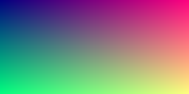
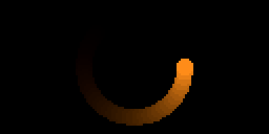
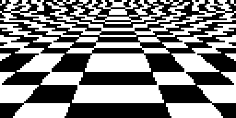
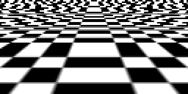
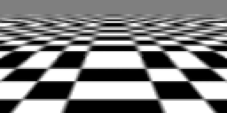
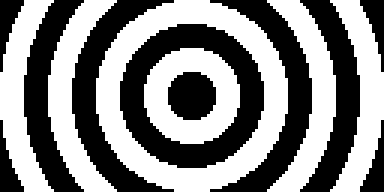
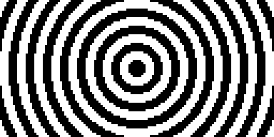
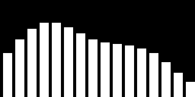

# Scenes

A scene is one or more GLSL fragment shaders, called passes, that ghee runs
every frame and puts on a display, into image files or into a stream. ghee
gives every shader [built-in names](#built-in-names), such as `uv`, the
pixel's position, and `iTime`, the time. You can have a pass read another
pass's picture, and values that change at runtime.

For example, this scene, `uv.scene.json`, holds one pass, which colours each
pixel by `uv`. `uv` runs from 0 to 1 across the picture, so red grows to the
right, and green grows up:

```json
{
  "version": 1,
  "passes": [{
    "name": "main",
    "fragment": "void main() { gl_FragColor = vec4(uv, 0.5, 1.0); }"
  }]
}
```

And you can render it to a PNG with the `ghee` command
([Install](../README.md#install)). The pictures on this page are drawn at
three times their size:

```shell
ghee render uv.scene.json -o uv.png --size 128x64
```



Without `--size`, ghee renders at a default size, or at the display's size with
`--display`. You can also render more frames, draw on a display, or watch and
edit the scene in the [console](console.md). [Outputs and
displays](displays.md) lists every output:

```shell
# frame.0000.png to frame.0059.png, with a timestep of 0.033 s
ghee render uv.scene.json -o frame.####.png --frames 60 --timestep 0.033
# the connected display, HDMI or a panel, until Ctrl-C
ghee render uv.scene.json --display kms
# the console, at http://127.0.0.1:8090
ghee serve uv.scene.json
```

You can do the same from Python: build the scene with `ghee.Scene`, render it
in your program with `ghee.open`, here with no display, and draw one frame
with `frame()` ([Python](python.md)):

```python
import ghee

scene = ghee.Scene(passes=[
    ghee.Pass("main", "void main() { gl_FragColor = vec4(uv, 0.5, 1.0); }"),
])
screen = ghee.open(scene, width=128, height=64)
screen.frame()
screen.save("uv.png")
```

## Built-in names

You can use these GLSL names in every pass:

| GLSL name | What it holds |
| --- | --- |
| `vec2 uv` | the pixel's centre in the buffer, from (0, 0) at its bottom left corner to (1, 1) at its top right |
| `vec4 gl_FragCoord` | the pixel's centre in pixels, (0.5, 0.5) for the bottom left pixel |
| `float iTime` | seconds since the first frame, or the frame's number times S under `--timestep S` |
| `float iTimeDelta` | seconds since the frame before |
| `int iFrame` | the frame's number, 0 first. It starts again at 0 after 1048576 frames |
| `vec3 iResolution` | the buffer's width and height in pixels, and 1 |
| `vec3 iOutputResolution` | the frame's width and height in pixels, and 1 |
| `sampler2D iChannel0`, `iChannel1`, ... | the buffer of each [channel](#channels) |
| `vec3 iChannelResolution[i]` | the width and height of channel i's buffer, and 1 |
| `float ghee_hash(p)` | a random value from 0 to 1 for a `float`, `vec2` or `vec3` `p`, the same on every GPU. It reads `p` to the nearest 1/2048, and a `vec2` or `vec3` repeats every 4096 along each axis |
| `float ghee_noise(p)` | smooth noise from 0 to 1 for a `vec2` or `vec3` `p`, built on `ghee_hash` |

`uv` and `gl_FragCoord` sit on the exact centre of the pixel on every GPU.
Both run y up, with y = 0 at the bottom, as in GL.

## The scene file

| Key | Values | Default | What it changes |
| --- | --- | --- | --- |
| `passes` | a list of [passes](#passes) | required | the shaders, in the order that they draw |
| `params` | `{"<name>": <param>}` | none | [params](#params) that every pass reads |
| `common` | GLSL, or `{"file": "common.glsl"}` | none | GLSL that ghee puts at the top of every pass, such as a function that two passes share |
| `assets` | `{"<name>": <asset>}` | none | image, font and [data](#data-files) files ([Assets](layers.md#assets)) |
| `filters` | a list of filter names, or of objects with a `name` and the filter's settings | none | passes that ghee adds after the scene's own, such as `dither` ([Filters](filters.md)) |
| `version` | `1` | `1` | the scene format's version |

Give a scene file a name that ends in `.scene.json`. A path in it is
relative to the file's folder.

## Passes

A pass is a fragment shader and the picture that it draws, which ghee calls
its buffer. The passes draw in order, and the last one makes the frame.

A pass is GLSL ES 1.00, or GLSL ES 3.00 when its first line is `#version 300
es`. One scene can hold both. `common` lands in every pass and compiles as
the GLSL of that pass, so GLSL ES 3.00 code in `common` breaks a GLSL ES 1.00
pass. A Pi Zero to Pi 3 can only run GLSL ES 1.00 ([Raspberry Pi](pi.md)).

In each pass, define `void main()`. In GLSL ES 1.00, write the colour to
`gl_FragColor`. In GLSL ES 3.00, declare an `out vec4` of your own and write
the colour to it. This GLSL ES 3.00 pass paints red across and green up:

```glsl
#version 300 es
out vec4 colour;
void main() { colour = vec4(uv, 0.0, 1.0); }
```

A pass that defines `mainImage` instead of `main` runs as a Shadertoy pass
([From Shadertoy](#from-shadertoy)). ghee writes the `precision` lines for
you, and turns on `fwidth`, `dFdx` and `dFdy` in GLSL ES 1.00 on every GPU
that has them. A shader that fails to compile stops `ghee render`, which
prints the pass, the line and the GPU's message.

| Key | Values | Default | What it changes |
| --- | --- | --- | --- |
| `name` | a [name](#names) | `"main"`, so a second pass needs a name | the name that a channel reads it by |
| `fragment` | GLSL, or `{"file": "main.glsl"}` | none: the pass then draws its [layers](layers.md) alone, over a transparent buffer | the shader |
| `channels` | a list of `{"buffer": "<pass>"}` | none | the buffers that it reads ([Channels](#channels)) |
| `params` | `{"<name>": <param>}` | none | [params](#params) that this pass alone reads |
| `arrays` | a list of `{"name": "<name>", "size": <size>}` | none | numbers that a program feeds it ([Arrays](#arrays)) |
| `layers` | a list of layers | none | text, images and shapes drawn over its buffer ([Layers](layers.md)) |
| `size` | `[w, h]` in pixels | the frame's size | the buffer's size ([Size and sampling](#size-and-sampling)). The pass that makes the frame draws at the frame's size whatever it sets |
| `scale` | a share of the frame, one number or `[x, y]` | `1` | the buffer's size, as a share of the frame's. A pass takes `size` or `scale` |
| `sampling` | `nearest`, `linear`, `trilinear` | `linear` | how every channel that reads this pass reads its buffer |
| `visible` | `true`, `false` | `true` | `false` skips the pass, which hands on the picture before it |

## Channels

List the buffers that a pass reads in its `channels`, and read them in its
shader: the first as `iChannel0`, the second as `iChannel1`, and so on. Use
`texture2D(iChannel0, uv)` to read the pixel at the same place. `texture2D`
takes a position from 0 to 1, so `uv` reads the same place whatever the
buffer's size ([Built-in names](#built-in-names)).

For example, the pass `disc` draws a white disc. The pass `main` reads it in
place, and again 6 pixels up and to the left, so the shadow falls down and to
the right:

```json
{
  "version": 1,
  "passes": [
    { "name": "disc", "fragment": { "file": "disc.glsl" } },
    { "name": "main", "channels": [{ "buffer": "disc" }], "fragment": { "file": "shadow.glsl" } }
  ]
}
```

`disc.glsl`:

```glsl
void main() {
  float d = length(gl_FragCoord.xy - 0.5 * iResolution.xy);
  gl_FragColor = vec4(vec3(clamp(20.0 - d, 0.0, 1.0)), 1.0);
}
```

`shadow.glsl`:

```glsl
void main() {
  float disc = texture2D(iChannel0, uv).r;
  float shadow = texture2D(iChannel0, uv + vec2(-6.0, 6.0) / iResolution.xy).r;
  vec3 color = mix(vec3(0.85), vec3(0.35), shadow);
  gl_FragColor = vec4(mix(color, vec3(1.0, 0.55, 0.1), disc), 1.0);
}
```


A pass can read any pass's buffer. Reading an earlier pass gives the picture that it
drew this frame. Reading itself, or a later pass, gives its picture from the
frame before, black on the first frame: that is [feedback](#feedback).

### Feedback

A pass that reads its own buffer gets its picture from the frame before. This
scene dims that picture a little, then draws a spot that circles, so the spot
leaves a trail:

```json
{
  "version": 1,
  "passes": [
    { "name": "main", "channels": [{ "buffer": "main" }], "fragment": { "file": "trail.glsl" } }
  ]
}
```

`trail.glsl`:

```glsl
void main() {
  vec2 spot = 0.5 * iResolution.xy + 24.0 * vec2(cos(iTime * 3.0), sin(iTime * 3.0));
  vec3 last = texture2D(iChannel0, uv).rgb;
  vec3 now = vec3(1.0, 0.55, 0.1) * step(length(gl_FragCoord.xy - spot), 4.0);
  gl_FragColor = vec4(max(last * 0.92 - 1.0 / 255.0, now), 1.0);
}
```



Careful: a buffer holds 8 bits for each of red, green, blue and alpha, on
every GPU ([Raspberry Pi](pi.md) says why). A dimming that only multiplies
stops short of black, so take a level, `1.0 / 255.0`, off too.

A value that a pass keeps from frame to frame, such as a position or a
speed, clamps to 0 to 1 in steps of 1/255. To keep it finer, store it in two
channels with these two functions, which hold a value from 0 to 1 in steps of
1/65535. Store a value from `lo` to `hi` as `(v - lo) / (hi - lo)`. The
[feedback example](../ghee/examples/feedback-common.glsl) packs its
particles' positions into bytes too.

```glsl
vec2 pack16(float v) {
  v = floor(clamp(v, 0.0, 1.0) * 65535.0 + 0.5);
  float hi = floor(v / 256.0);
  return vec2(hi, v - hi * 256.0) / 255.0;
}

float unpack16(vec2 e) {
  e = floor(e * 255.0 + 0.5);
  return (e.x * 256.0 + e.y) / 65535.0;
}
```

A feedback pass changes its picture once a frame, so its trail is shorter
at a higher frame rate. On a display, ghee draws at the display's pace, and
in the console it draws as fast as it can while a page or a stream watches.
Under `ghee serve` with no display and nobody watching, ghee draws a frame
only for a request that changes the scene or asks for `/frame.png`. To keep
the same trail everywhere, set the rate with `--fps`, such as `--fps 30`.

### Size and sampling

A pass draws at the frame's size. To draw it at another size, set `size` or
`scale`. A channel reads a buffer of any size through `uv` all the same, and
you set how with the pass's `sampling`. For example, this pass draws a
checker at 64x64:

```json
{ "name": "checker", "size": [64, 64], "sampling": "nearest", "fragment": { "file": "checker.glsl" } }
```

A later pass reads it as a floor in perspective, bigger than it is at the
bottom and smaller at the top:

| `nearest` | `linear` | `trilinear` |
| --- | --- | --- |
|  |  |  |

| Sampling | What a channel reads | Use it for |
| --- | --- | --- |
| `nearest` | the nearest pixel, whole | crisp pixels, and exact copies |
| `linear` | the four pixels around the point, blended | a buffer read at its size or bigger |
| `trilinear` | smaller copies of the buffer too, made after each frame | a buffer read smaller than it is, which breaks into patterns under `linear` |

### From Shadertoy

To run a Shadertoy shader, put each of its passes in a pass of its own,
its Common tab in the scene's `common`, and the inputs of each pass in its
`channels`, in the order of `iChannel0` and up. Start each pass with
`#version 300 es`, and the pass compiles as written. In a GLSL ES 1.00
pass with `mainImage`, `texture` reads as `texture2D`.

Careful: a buffer holds 8 bits a channel, from 0 to 1. A pass that keeps
state from frame to frame in its buffer, such as a position, a count or a
signed value, packs it as shown in [Feedback](#feedback).

## Params

A param is a named value that a pass reads, and that you change at
runtime. For example, `rings` sets how many rings this pass draws:

```json
{
  "name": "main",
  "fragment": { "file": "rings.glsl" },
  "params": {
    "rings": { "type": "float", "value": 4, "min": 1, "max": 12, "step": 1 }
  }
}
```

`rings.glsl`:

```glsl
void main() {
  float d = length(gl_FragCoord.xy - 0.5 * iResolution.xy) / iResolution.y;
  gl_FragColor = vec4(vec3(step(0.5, fract(d * rings))), 1.0);
}
```

| `"value": 2` | `"value": 4` | `"value": 8` |
| --- | --- | --- |
|  |  |  |

The [console](console.md) shows each param as a control. From Python, set it
for the next frame with `screen.set_param("rings", 8)`, or with `POST /set`
([HTTP API](http.md)).

| Key | Values | Default | What it changes |
| --- | --- | --- | --- |
| `type` | a type below | required | the type in GLSL |
| `value` | a value of the type | required | the value |
| `min`, `max` | numbers | set by the console | the ends of the console's slider |
| `step` | a number | set by the console | the console's slider step |
| `options` | a list of strings | none | a `string` param's choices, as a menu in the console |

| Type | In GLSL | Value |
| --- | --- | --- |
| `float` | `float` | a number |
| `int` | `int` | a whole number |
| `bool` | `bool` | `true`, `false` |
| `color` | `vec3` | a [colour](#colours) |
| `vec2`, `vec3`, `vec4` | the same | 2, 3 or 4 numbers |
| `string` | none | text, for a [procedural scene](#procedural-scenes) to read |

The console shows a `vec2` whose value lies between opposite `min` and
`max`, -1 and 1 unless you set them, as a direction pad. It shows any other
`vec2`, such as a position in pixels, as two numbers, x and y.

A param in a pass's `params` reaches that pass alone. Declare it in the
scene's own `params` to make it reach every pass.

### Colours

Write a colour as a CSS hex colour, `"#rgb"`, `"#rgba"`, `"#rrggbb"` or
`"#rrggbbaa"`, a CSS colour name such as `"navy"`, or `[r, g, b]` from 0 to
1. A colour param, a layer's `color` and a border's `color` all take it. A
colour param is a `vec3`, and drops the alpha.

## Arrays

An array is a list of numbers that a program feeds to a pass at runtime,
such as the levels of a spectrum. Set its shape with `size`:
`"size": 16` is a list of 16 numbers, and `"size": [16, 2]` a grid 16 wide
and 2 high, fed as one list of 32 numbers, the top row first.

In GLSL, read a list called `levels` with `levels_count`, how many numbers it
holds, `levels_at(i)`, number `i` from 0, and `levels_sample(t)`, the numbers
blended at `t`, from 0 to 1 along the list. Read a grid with
`levels_sample2(p)`, the numbers blended at `p`, from 0 to 1 across the grid
and y up, so `levels_sample2(uv)` spreads the grid over the buffer with its
top row at the top.

This pass declares a list of 16 numbers, and draws a bar for each:

```json
{ "name": "main", "fragment": { "file": "bars.glsl" }, "arrays": [{ "name": "levels", "size": 16 }] }
```

`bars.glsl`:

```glsl
void main() {
  float x = uv.x * float(levels_count);
  float level = levels_at(int(x));
  float bar = step(uv.y, level) * step(0.2, fract(x));
  gl_FragColor = vec4(vec3(bar), 1.0);
}
```

Under `ghee render` and the console, an array that nothing feeds holds a
wave that moves from 0 to 1, so the bars show on their own:



From Python, feed the array for the next frame with
`screen.feed("levels", values)`. With `ghee.open`, the array holds zeros until the first `feed`. A
[procedural scene](#procedural-scenes) feeds it each frame.

On a Pi Zero to Pi 3, an array holds 8 bits a value, so a value outside 0 to 1
clamps. A Pi 4 or Pi 5, and a desktop, hold any number, as a 32-bit float
([Raspberry Pi](pi.md)).

## Data files

In any pass, read an image asset `noise` as `sampler2D noise_tex`, and its
width and height in pixels as `vec2 noise_size` ([Images in a
shader](layers.md#images-in-a-shader)). Read a `.raw` asset the same way: a
file of bare pixels, such as a table of noise, whose layout you declare in its
asset entry:

```json
"assets": { "noise": { "file": "noise.raw", "width": 64, "height": 64, "format": "u8" } }
```

| Key | Values | Default | What it changes |
| --- | --- | --- | --- |
| `width`, `height` | pixels | required | the size |
| `format` | `u8`, a byte a value, or `f32`, a little-endian 32-bit float | required | how the file stores a value |
| `components` | `1`, `3`, `4` | `1` | the values in a pixel, read in `.r`, `.rgb` or `.rgba` |
| `sampling` | `nearest`, `linear` | `nearest` | how a shader reads it |

## Names

The names of passes, layers, assets and scene params share one pool, and
each must be unique. A pass's own params and arrays only need to differ
inside that pass, so two passes can each have a param `gain`.

A name holds ASCII letters, digits and `_`, starts with a letter, and ends
with a letter or a digit, with no `__` anywhere, and no `gl_` or `ghee` at the
start. A name also can't be one of ghee's [built-in names](#built-in-names),
or a GLSL name that ghee makes from another of your names, such as
`levels_at` from an array `levels` or `title_size` from a text layer `title`.

## Procedural scenes

A procedural scene is a program that writes a scene and feeds it every frame,
such as the levels of a spectrum. ghee runs it in place of a scene file
([Procedural scenes](procedural.md)), and [Python scenes](python.md#python-scenes)
shows how to write one in Python.

## Where ghee finds a scene

You can give `ghee render` a scene in any of these forms:

| You give | ghee renders |
| --- | --- |
| `bars.scene.json` | the scene file, or an executable `bars.*` beside it (Careful below) |
| `clock.py`, or any executable file | the program's scene |
| a folder `bars/` | `bars/bars.scene.json`, or an executable `bars/bars.*` |
| `bars` | `bars.scene.json`, an executable `bars.*` or a folder `bars/`, in the working directory, then in each folder of `$GHEE_SCENES`, a colon-separated list |
| `--demo bars` | the example `bars` |

Careful: an executable file that shares a scene file's name, such as `bars.py`
or `bars.sh` beside `bars.scene.json`, runs in its place, even when you give
`bars.scene.json`.

Careful: procedural scenes are executables, and ghee runs them. Only put
directories you trust on `$GHEE_SCENES`.

ghee keeps the examples that `--demo` unpacks, its glyph atlases and the
index of the `ghee-render` wheel in its cache, `~/.cache/ghee` by default,
or `ghee` in `$XDG_CACHE_HOME`. To move it, set `$GHEE_CACHE`.

You can give `ghee serve` the same forms. Give it a folder, and it serves
every scene in it. With no scene, it serves the scenes that you make in the
[console](console.md). Each sits in a folder of its own, in
`~/.local/share/ghee/scenes` by default: `glow/glow.scene.json`, beside a
`.glsl` file for each pass. To render one, give `ghee render` its folder:
`ghee render ~/.local/share/ghee/scenes/glow`.

## Examples

To render one of the scenes that come with ghee, use `ghee render --demo
<name>`. To open them all in the console, use `ghee serve --demo`. `assets`, `bars`,
`feedback`, `lens`, `neon`, `passes` and `tiltshift` are scene files, and
`hero`, `karaoke`, `nowplaying`, `spectrum` and `stats` are Python scenes.
Each file in [ghee/examples](../ghee/examples) opens with what it shows.

## Limits

| Limit | Cap |
| --- | --- |
| passes in a scene, filters included | 16 |
| textures that one pass reads: its channels and arrays, the assets that it samples, and the text layers that it reads ([Text in a shader](layers.md#text-in-a-shader)) | 16, or the GPU's own count when lower |
| a pass's `size`, an array, a `.raw` file | 16384 pixels a side, and 16777216 in all |
| an image or an array | the GPU's own texture size ([Raspberry Pi](pi.md) has each Pi's) |
